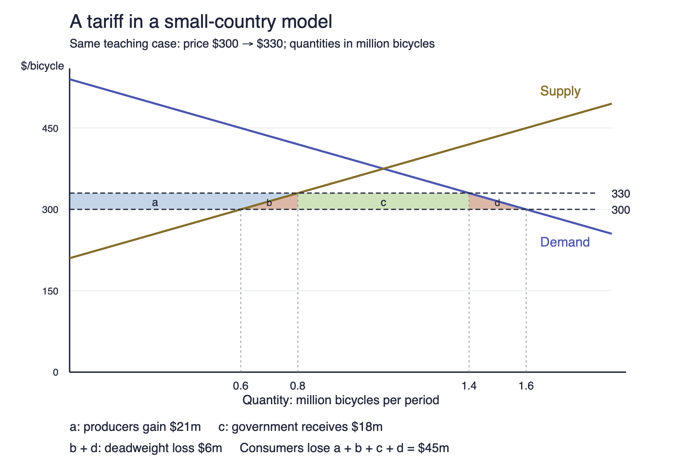

# International Business — appunti didattici / complete learning notes

**Percorso:** quattro incontri documentati del 23 e 30 settembre, 7 e 14 ottobre 2026, più le slide ufficiali disponibili. Parti da una domanda concreta: che cosa cambia per un'impresa quando un cliente, un fornitore, un concorrente, una regola o una sua attività si trova oltre confine? Ogni capitolo costruisce la risposta dalle premesse. Esempi aggiunti ed esercizi sono ipotetici; le informazioni sul perimetro delle fonti sono in appendice.

# PART I — ITALIANO (con definizioni inglesi)

## 1. Perché esiste l'International Business

**International business (IB)** means *business activities involving trade or investment across national borders*. Un'impresa italiana che vende solo in Italia può dipendere da un chip importato, da un cliente che esporta o da un concorrente estero. Quindi «internazionale» non descrive soltanto dove si fattura: descrive anche da dove arrivano risorse, idee, concorrenza e regole. Il confine conta perché cambiano moneta, lingua, leggi, tasse, trasporti e possibilità di far valere gli accordi.

**International trade** is *the exchange of goods or services across borders*. **Exporting** significa vendere oltre confine; **importing** significa comprare oltre confine. **Global sourcing** is *obtaining inputs from suppliers in different countries*: riguarda acquisti di componenti, servizi o conoscenze, anche se il prodotto finale è venduto in patria. **Foreign direct investment (FDI)** is *an investment giving lasting managerial influence in a foreign enterprise or operation*: è una scelta di presenza e controllo, diversa da un singolo ordine di esportazione. Una fabbrica posseduta all'estero è un esempio; l'acquisto di cento pezzi da un fornitore estero non lo è.

Perché fare una scelta internazionale? Si può cercare un mercato, una risorsa, efficienza, una competenza strategica oppure seguire un cliente. Il beneficio va confrontato con capitale richiesto, coordinamento e rischio. **Trade-off** means *giving up some benefit to obtain another*: un distributore locale costa meno di una filiale, ma l'impresa controlla meno l'esperienza del cliente. **Opportunity cost** is *the value of the best alternative forgone*. Se 100.000 € sono impegnati in un nuovo magazzino, non possono finanziare nello stesso momento l'assistenza tecnica: il costo della scelta include il rendimento dell'alternativa migliore, non solo la fattura del magazzino.

**Vantaggio comparato (comparative advantage)** significa costo opportunità relativamente minore, non essere «il migliore in assoluto». Esercizio ipotetico: in una giornata A può fare 10 macchine oppure 20 servizi; B può fare 6 macchine oppure 18 servizi. Per A una macchina costa 2 servizi rinunciati; per B costa 3. A ha vantaggio comparato nelle macchine. Per un servizio A rinuncia a 0,5 macchine, B a 1/3: B ha vantaggio nei servizi, benché A sia più produttivo in entrambe le attività. Un prezzo di scambio fra 2 e 3 servizi per macchina può creare spazio per un guadagno reciproco. Scegliamo **2,5 servizi per una macchina**: A sacrifica 2 servizi producendola e ne riceve 2,5 scambiandola, quindi guadagna 0,5 servizi rispetto all’alternativa. B rinuncia a 2,5 servizi per acquistarla, anziché ai 3 necessari per produrla internamente: risparmia anch’esso 0,5 servizi. Il vantaggio nasce dalla differenza nei costi opportunità. Supponiamo produzioni divisibili, rapporti produttivi costanti e assenza di costi di scambio; nella realtà queste ipotesi vanno valutate. Nella pratica contano qualità, trasporto, regole e distribuzione dei benefici: il modello non promette che ogni lavoratore vinca.

**Come rispondere in aula.** Parti da attività e confine, poi spiega la scelta e il costo opportunità: «L'impresa può esportare senza investire in una fabbrica estera; confronta margine, controllo e servizio. La scelta migliore dipende dall'attività che deve essere vicina al cliente».

**Esercizio inventato.** Una PMI compra componenti esteri e vende solo in Italia. È oggetto dell'IB? **Risposta spiegata:** sì: sourcing, trasporto, cambio e possibili dazi attraversano il confine. Non serve che la vendita finale sia estera. La domanda successiva è quali di questi legami cambiano costo, qualità o continuità del prodotto.

## 2. Dalla parola «mercato» a una decisione verificabile

Un paese grande non è automaticamente un grande mercato per un prodotto specifico. **Operationalisation** is *turning a broad concept into observable measures*. Definisci il cliente servibile, il periodo e l'unità. **Indicator** is *an observable measure*; **proxy** is *an indirect measure used when the desired fact cannot be observed directly*. La popolazione è un proxy debole della domanda di macchine industriali se non sappiamo quante imprese possono comprarle. Se due paesi hanno 50 milioni di abitanti ma il segmento pertinente vale rispettivamente 2% e 12%, i potenziali clienti sono 1 e 6 milioni, prima di verificare reddito, canali e concorrenza.

**Purchasing power parity (PPP)** is *a conversion that accounts for differences in local price levels*. Serve per confrontare ciò che il denaro permette di comprare, non è il cambio bancario da usare in una fattura. Se una statistica sulla povertà usa una soglia in dollari internazionali PPP, non puoi sostituirla con il tasso di cambio di oggi. 

**PPP, esempio svolto.** Un *paniere* è una combinazione definita di beni e servizi: lo usiamo per confrontare la stessa capacità di acquisto in due paesi. Immagina che un identico paniere costi 10 dollari negli Stati Uniti e 20 unità monetarie nel paese B. Il fattore PPP è `20/10 = 2 unità di B per dollaro internazionale`. Un reddito di 200 unità di B equivale quindi a `200/2 = 100 dollari internazionali`: permette di comprare dieci panieri, come 100 dollari negli Stati Uniti. Il **dollaro internazionale** è un’unità di confronto del potere d’acquisto, non una moneta che puoi prelevare.

Se il cambio di mercato è invece 4 unità di B per dollaro USA, il medesimo reddito convertito in banca vale `200/4 = 50 dollari USA`. Le due cifre rispondono a domande diverse: 100 confronta ciò che puoi comprare localmente; 50 indica i dollari ottenibili a quel cambio, prima di commissioni. Non hai guadagnato denaro cambiando metodo statistico. Il paniere singolo è una semplificazione didattica: le PPP statistiche combinano molti prodotti e servizi e richiedono confrontabilità e pesi di spesa.

**Correlation** means *two quantities move together*; **causation** means *one change helps produce the other*. Se esportazioni e reddito crescono insieme, istruzione, investimenti o politiche possono aver influito su entrambi. Una buona risposta dice quale meccanismo si ipotizza e quale prova potrebbe smentirlo.

Prima di entrare in un mercato scegli l'**entry mode**, cioè *the organisational way a firm serves a foreign market*. Export con distributore, licenza, partnership, filiale e produzione propria impegnano risorse e controllo diversi. Una macchina che necessita di assistenza entro 48 ore può perdere clienti se l'export non include tecnici e ricambi locali. La domanda non è «quanto è grande il paese?», ma «quale combinazione di prodotto, canale e servizio genera valore dopo tutti i costi?».

**Standardisation** is *using a common product or process across markets*; **adaptation** is *changing it for a local use, rule or preference*. Una piattaforma di macchina da caffè comune riduce il costo di progettazione per unità se vendi più pezzi; prese, manuali e assistenza possono essere adattati. Supponi, in un esercizio inventato, che l'adattamento costi 20 € per unità e riduca resi e fermo macchina per 35 €: il vantaggio incrementale apparente è 15 € per unità. Va ancora confrontato con il costo fisso della rete di assistenza e con il volume reale. Le **economies of scale** sono la riduzione del costo medio quando un costo fisso viene ripartito su più unità, purché produrle e venderle sia possibile.

Nel caso didattico Renault–Geely in Brasile, produzione locale, quota proprietaria e accesso a un altro mercato sono tre domande diverse. Una partnership può combinare capacità e distribuzione di un partner con prodotto e tecnologia dell'altro. Per decidere occorre conoscere controllo, costi, utilizzo dell'impianto e regole commerciali del prodotto. La presenza di uno stabilimento in Brasile, da sola, non dimostra esenzione dai dazi nell'UE. Il **payback period** is *the time for cumulative net cash inflows to recover initial investment*. Esempio inventato: investimento 200.000 €, entrate nette 50.000 € annue costanti ⇒ 4 anni. Questo conto ignora ciò che accade dopo, il rischio e il valore del denaro nel tempo: è un primo filtro, non una valutazione completa.

**Come rispondere in aula.** «Definisco il segmento, misuro la domanda servibile, scelgo le attività da tenere comuni e quelle da adattare, poi confronto export e presenza locale sul costo totale e sulla qualità del servizio».

Un bene **usato** può creare una relazione internazionale tanto quanto un bene nuovo: se una macchina di seconda mano viene rivenduta a un cliente estero, servono ancora verifica delle condizioni, documenti, trasporto, eventuali requisiti e assistenza. Il prezzo più basso non basta se il cliente non può ottenere ricambi. Qui il valore può venire dalla capacità di ispezionare, riparare e garantire il bene; chi possiede questa capacità può differenziarsi anche senza fabbricare una macchina nuova. È un esempio di come la catena del valore continui dopo la prima vendita.

**Esercizio inventato.** Un mercato ha 10 milioni di abitanti e 1% di possibili acquirenti; un altro 5 milioni e 5%. Quale ha più potenziali acquirenti? **Risposta:** 100.000 nel primo, 250.000 nel secondo. È ancora una stima di segmento, non una previsione di vendite: servono capacità di pagamento, accessibilità e concorrenza.

## 3. Da dove viene il margine: catena del valore e cinque forze

**Value chain** is *the sequence of activities that develop, produce, sell and support an offering*. Design, approvvigionamento, produzione, logistica, marketing e assistenza non sono la stessa cosa e possono trovarsi in paesi o imprese differenti. **Value added** è il valore dell'output meno il valore degli input comprati: se un'impresa vende un componente a 80 € usando input acquistati per 50 €, aggiunge 30 € di valore, prima di attribuire salari, ammortamenti e utile. Non è automaticamente profitto. La catena chiede **dove si crea valore e dove si sostiene costo**.

Le **Five Forces** di Porter chiedono invece **chi può sottrarre parte di quel valore** nel settore definito. Una forza è una pressione sul margine potenziale, non un reparto aziendale. Definisci prima prodotto, area geografica, clienti e periodo: il settore dei produttori d'auto non coincide con quello dei concessionari.

1. **Rivalry among existing competitors** è la pressione delle imprese già presenti. Aumenta quando molte offerte sono percepite come simili, la domanda cresce lentamente o imprese con capacità vuota tagliano prezzi. Una quota di mercato non racconta tutta la storia: due imprese dominanti possono combattersi duramente.
2. **Threat of new entrants** è la facilità con cui un nuovo operatore può aggiungere offerta. Se servono grandi investimenti, autorizzazioni, rete distributiva o reputazione, l'ingresso è più difficile. Le **economies of scale** possono favorire chi ha già grandi volumi, ma una tecnologia nuova può abbassare la barriera. Chiedi che cosa un entrante dovrebbe costruire e quanto tempo richiederebbe.
3. **Threat of substitutes** riguarda una soluzione diversa allo stesso bisogno, non un altro marchio dello stesso prodotto. La videoconferenza può sostituire parte dei viaggi d'affari perché permette una riunione; non sostituisce ogni incontro. Conta il rapporto fra prezzo, prestazione e fatica di cambiare soluzione.
4. **Supplier power** è il potere di chi vende input all'impresa. Un fornitore unico di un chip critico può chiedere prezzo o condizioni migliori; il potere cala se esistono alternative qualificate e cambiare costa poco. La percentuale di costo del chip non basta: anche un pezzo economico può fermare l'intera produzione.
5. **Buyer power** è il potere di chi compra l'output. Un cliente che rappresenta metà delle vendite può imporre sconti, soprattutto se può passare facilmente a un rivale. Il potere si riduce quando l'offerta è indispensabile o cambiare comporta rischi e costi.

**Approfondimento della rivalità.** Immagina tre produttori di pezzi standard con impianti capaci di fare 1.000 unità, ma ordini totali per 1.800. Ciascuno cerca volumi per assorbire gli affitti degli impianti. Uno taglia il prezzo; gli altri possono reagire per non lasciare inutilizzate le macchine. Il risultato potrebbe essere più pezzi venduti da un'azienda senza crescita della domanda totale, quindi margini più bassi per tutti. Per valutare questa forza osserva capacità, prezzo realmente pagato e crescita delle unità. Se i pezzi sono invece personalizzati e difficili da sostituire, la pressione può essere diversa anche con lo stesso numero di rivali.

**Approfondimento dell'ingresso.** Una nuova impresa vuole vendere farmaci: non basta trovare una fabbrica economica. Deve finanziare sviluppo, dimostrare qualità, rispettare autorizzazioni e raggiungere prescrittori e distributori. Questi requisiti alzano tempo e capitale necessari e possono proteggere gli operatori presenti. Il rovescio è che un incumbent può diventare meno efficiente se si sente troppo protetto. Un'innovazione nei processi o una nuova regola può cambiare le barriere, quindi verifica l'entrata possibile nel mercato e nel periodo scelti.

**Approfondimento dei sostituti.** Un'impresa vende viaggi di lavoro. Se le videoriunioni migliorano, una parte delle riunioni si trasferisce online; l'impresa non perde necessariamente vacanze o viaggi che richiedono presenza fisica. Un rimedio può essere puntare sulle occasioni che il video serve male, ma questo limita il mercato potenziale. La prova è osservare quali clienti rinunciano al viaggio dopo un miglioramento del sostituto, non contare soltanto altre compagnie aeree.

**Approfondimento dei fornitori.** Una PMI usa una lega speciale certificata da un unico venditore. Quel venditore può alzare il prezzo o imporre tempi lunghi, perché qualificare una lega alternativa richiede prove. La PMI può finanziare un secondo fornitore: paga oggi test e minori sconti di volume per ridurre dipendenza domani. Chiedi quanti sostituti davvero qualificati esistono, quanto costa cambiare e per quanto tempo la produzione resterebbe ferma.

**Approfondimento degli acquirenti.** Una catena retail compra il 50% della produzione di una marca piccola e minaccia di passare a un'altra. La marca può concedere uno sconto, ma perderà margine; può anche sviluppare altri canali, al costo di marketing e gestione. Se i consumatori cercano espressamente quel marchio, anche il retailer rischia di perdere traffico: il potere è una relazione, non un'etichetta legata solo alla dimensione. Verifica quota degli acquisti, alternative credibili e costo del cambio per entrambe le parti.

**Price elasticity of demand** is *the percentage change in quantity demanded divided by the percentage change in price, other things equal*. Se un prezzo sale del 10% e le unità richieste scendono del 20%, l'elasticità approssimata è −2: i clienti sono relativamente sensibili al prezzo. È un'ipotesi di confronto, non prova causale se contemporaneamente cambiano pubblicità o reddito. Una differenziazione credibile può rendere la domanda meno sensibile, ma va misurata sui prezzi effettivi, non sui soli listini.

**CR5 (five-firm concentration ratio)** è la somma delle quote dei cinque maggiori operatori nello stesso mercato definito. Quote 25%, 20%, 15%, 10%, 8% danno 78%. Non implica automaticamente collusione, scarsa rivalità o profitti: va confrontato con prezzi, differenziazione, crescita, capacità e ingresso. **Fixed costs** restano nel breve periodo anche se produci zero, per esempio affitto e macchinario; **variable costs** aumentano con le unità, per esempio materiali. Con prezzo 20 €, costo variabile 12 € e fisso 400 €, ogni unità venduta contribuisce 8 € ai fissi: il **break-even** è 400/8 = 50 unità, se tutto il resto resta costante. Se una fabbrica da 100 unità ne vende 60, può offrire sconti per usare capacità libera; se lo sconto deve valere anche sui clienti esistenti, il profitto può calare. Una **exit barrier** è un costo o vincolo che rende difficile uscire, come penali o impianti poco rivendibili: mantiene capacità e pressione sui prezzi nel settore.

**Come rispondere in aula.** Nomina la forza, descrivi il meccanismo, proponi una misura e un limite. «La rivalità potrebbe essere alta perché c'è capacità inutilizzata; guarderei sconti effettivi e utilizzo degli impianti. Il CR5 da solo non basta».

**Esercizio inventato.** A prezzo 20 € vendi 60 pezzi con costo variabile 12 € e fisso 400 €: risultato 60×8−400=80 €. Se vendi 20 pezzi nuovi a 16 € mantenendo gli altri a 20 €, aggiungi 20×4=80 €. Se per farlo devi abbassare a 16 € anche i 60 vecchi, 80×4−400=−80 €. **Spiegazione:** conta chi riceve lo sconto; riempire la capacità non garantisce un margine migliore.

## 4. Un mondo connesso, ma non uniformemente «piatto»

**Globalisation** is *growing cross-border integration and interdependence*. La tesi del **flat world** mette in evidenza software, internet, collaborazione e catene di fornitura capaci di coordinare persone lontane. Nella slide dei dieci *flatteners*, caduta del Muro e diffusione commerciale del web rappresentano aperture; workflow software e open sourcing permettono lavoro e conoscenza condivisi; outsourcing, offshoring e supply chaining riconfigurano attività; insourcing integra capacità specialistiche nelle operazioni del cliente; ricerca online e dispositivi digitali ampliano accesso. Sono meccanismi diversi: trovare un fornitore non prova che sia affidabile, e un file digitale non sposta un macchinario attraverso la dogana.

La **semiglobalisation** di Ghemawat chiede di guardare quanto ciascun flusso attraversi davvero confini. Persone, capitale, merci e informazioni hanno costi e regole diversi. Un'impresa con 20 milioni di vendite estere su 100 milioni totali ha quota estera del 20%; non segue che il 20% di tutta l'economia mondiale sia internazionale. Se la quota sale al 25%, controlla se crescono le vendite estere o calano quelle domestiche. Le percentuali delle slide su produzione di filiali estere ed export/PIL sono dati storici con denominatori differenti e non vanno sommate o trattate come valori 2026.

La tecnologia può ridurre il costo della comunicazione mentre trasporto, fusi, lingua, norme e fiducia rimangono. **Tier 1 supplier** vende direttamente al produttore finale; **tier 2** vende a un fornitore del produttore. Il livello cambia in una filiera diversa. Dati condivisi sugli stock aiutano a coordinare acquisti, ma qualità, proprietà dei pezzi, responsabilità e contratto vanno ancora gestiti. In uno shock, una filiera può ritirarsi, regionalizzarsi o sostituire fornitori senza che «tutta la globalizzazione» finisca. Definisci flusso, settore, geografia e periodo prima di sostenere una tesi.

**Come rispondere in aula.** «Per i file digitali la distanza pesa meno; per componenti fisici contano dogana, consegna e servizio. Misurerei separatamente export, investimento e flussi informativi, con anno e denominatore».

**Esercizio inventato.** Una PMI progetta con un freelance estero e compra parti da una fabbrica nella propria regione. Quale attività è internazionale? **Risposta:** la progettazione collaborativa attraversa il confine; l'acquisto fisico, nel dato fornito, no. Non basta chiamare l'intera impresa «globale»: mappa le attività.

## 5. Attori, partner e consegna

La **focal firm** è l'impresa da cui osserviamo la transazione. Una **multinational enterprise (MNE)** gestisce attività sostanziali in più paesi; una **small or medium-sized enterprise (SME)** ha risorse minori rispetto a grandi gruppi, ma può esportare, servire nicchie e usare partner. La soglia generica «500 addetti» nella slide è descrittiva del materiale, non la definizione giuridica UE. Una **born global** internazionalizza presto e in modo significativo, spesso usando una nicchia e reti digitali; «presto» non significa senza costi o senza apprendimento.

La differenza fra MNE e PMI cambia la *configurazione* possibile, non il diritto di essere internazionale. Una MNE può distribuire costi fissi di ricerca, marchio e controllo qualità su molti mercati, ma coordina impianti e regole differenti. Una PMI può reagire più rapidamente a una nicchia, ma un singolo errore doganale o partner perso pesa di più sul suo bilancio. Una born global di componenti specializzati può cercare clienti esteri fin dall'inizio perché il suo mercato nazionale è troppo piccolo; deve comunque dimostrare qualità, proteggere liquidità e costruire assistenza. Nessuna categoria dice da sola chi avrà margine maggiore.

Un **distribution intermediary** compra, consegna o commercializza attraverso un canale; un **facilitator** fornisce una competenza come dogana, finanza, legge o ricerca di mercato. Governo e istituzioni stabiliscono o applicano condizioni e infrastrutture. La PMI può evitare una filiale costosa usando un distributore, ma rischia di dipendere dal suo accesso al cliente. La soluzione è un accordo verificabile su territorio, dati, assistenza, qualità e gestione delle contestazioni.

Gli **Incoterms** sono regole commerciali standard che chiariscono fra venditore e compratore alcuni compiti, costi e passaggio del rischio nella consegna della merce. Non fissano automaticamente proprietà, prezzo, metodo di pagamento, copertura assicurativa in ogni formula né soluzione delle controversie. Per interpretare una vendita devi sapere il termine concordato, luogo nominato e versione applicabile; la lezione disponibile introduce il concetto, non un elenco completo da memorizzare. Un prezzo «basso» alla partenza può diventare alto dopo trasporto, sdoganamento e ritardi. **Landed cost** è il costo totale per avere il bene nel luogo d'uso, secondo le voci pertinenti; confronta sempre offerte sullo stesso perimetro di consegna.

**Servitisation** significa affiancare al bene un servizio o vendere un risultato d'uso. Una macchina industriale può essere venduta con installazione, manutenzione e tempi garantiti di riparazione. Il produttore ottiene ricavi ricorrenti e dati sul funzionamento; assume però costi di tecnici, ricambi e responsabilità di risposta. Se il macchinario si ferma all'estero, la promessa di servizio può valere più di un piccolo sconto sul prezzo iniziale. Occorre misurare tempi di fermo, costo del servizio e capacità del partner locale: il contratto non crea tecnici dal nulla.

**Come rispondere in aula.** «Identifico l'impresa focale, chi vende, chi distribuisce, chi sdogana e chi supporta il cliente. Poi verifico dove passano costo e rischio nella consegna».

**Esercizio inventato.** Un distributore promette vendite elevate ma non dispone di tecnici per un prodotto che richiede installazione. **Risposta spiegata:** il canale è incompleto. Stima valore degli ordini perso per guasti o attesa, inserisci formazione e scorte di ricambi nel contratto, oppure scegli un partner tecnico. La previsione commerciale non compensa da sola un servizio impossibile.

**Chi può influenzare una filiera senza possederla?** Organismi internazionali, associazioni e ONG possono produrre informazioni, promuovere standard e modificare le aspettative dei clienti. Immagina, come caso ipotetico, un problema di sicurezza documentato presso un fornitore di secondo livello (*tier 2*: fornitore del tuo fornitore). Un’ONG pubblica prove, clienti chiedono spiegazioni e un distributore sospende ordini. La *focal firm*, l’impresa al centro della catena considerata, subisce un rischio reputazionale e commerciale anche senza possedere quello stabilimento. Deve verificare le prove, risalire agli ordini coinvolti, chiedere e controllare una correzione e comunicare ciò che è dimostrabile. Questo è un problema di **supply-chain accountability**: chi risponde delle pratiche e dei risultati lungo la catena?

Uno **standard volontario** è un impegno che un’impresa sceglie di adottare; un **requisito contrattuale** diventa un obbligo fra le parti del contratto; una **legge** è un obbligo giuridico nel proprio ambito. Possono sovrapporsi ma hanno autorità e modalità di controllo diverse. La pressione reputazionale può indurre cambiamenti anche prima di un obbligo legale. La reputazione non si ripara soltanto con un messaggio: occorrono pratica corretta, prova e verifica nel tempo.

## 6. Progettare la catena internazionale

Dividi la catena in attività: ricerca, progetto, componenti, assemblaggio, vendita, assistenza. Per ciascuna chiedi **che cosa, dove, chi controlla, perché**. La mappa iPhone delle slide è un esempio storico qualitativo: mostra progettazione, parti, assemblaggio e marketing in luoghi e imprese differenti, non una mappa attuale né la quota di utile di ogni paese. Un'operazione di assemblaggio può essere essenziale e avere un valore aggiunto contabilizzato diverso da design o marca; valore aggiunto, salari e profitti non sono sinonimi.

Una filiera farmaceutica rende evidente la **specializzazione**: ricerca, preparazione di un materiale, trasformazione, controllo di qualità e trasporto in condizioni corrette possono richiedere competenze diverse. Il meccanismo è requisito del prodotto → capacità richiesta → scelta del soggetto → controllo del risultato e del passaggio alla fase successiva. Esempio inventato: un materiale è lavorato correttamente, ma perde una caratteristica necessaria durante il trasporto. La fabbrica può aver svolto bene il proprio compito e il risultato finale essere inutilizzabile. Per questo la mappa della catena deve includere logistica e responsabilità, non solo dove si compra a minor prezzo. Non serve attribuire dati tecnici o imprese specifiche al parlato incerto per imparare questo nesso.

Una catena **modulare** separa attività con interfacce definite: specifiche su ciò che entra, esce e va verificato. Se un componente rispetta forma e prestazioni concordate, puoi forse sostituire il fornitore senza riprogettare tutto; se cambia un requisito essenziale, anche assistenza e assemblaggio vanno testati. La modularità offre flessibilità ma costa progettazione e verifica delle interfacce. Il **follow-the-sun** distribuisce lavoro fra fusi orari per far proseguire un'attività quando un gruppo termina la giornata. Funziona solo se il passaggio di consegne include stato, decisioni, test falliti e responsabile successivo; una nota «non funziona» può far perdere più tempo di quanto il fuso ne faccia risparmiare. Produttività significa output utile rispetto agli input, non ore totali con qualcuno online; efficacia significa ottenere il risultato richiesto, non soltanto spendere meno.

**Outsourcing** is *contracting an activity to another firm*. **Offshoring** is *locating an activity in another country*. Sono due assi indipendenti: produzione propria in patria; terzista in patria; propria filiale estera; terzista estero. Spostare una fabbrica propria all'estero è offshoring senza outsourcing. Affidare la produzione a un vicino è outsourcing senza offshoring. La matrice delle reti aperte nella slide serve a non confondere proprietà e luogo. **Reshoring** è riportare un'attività verso il paese d'origine; non è automaticamente internalizzarla.

Perché collocare una fase altrove? **Resource seeking** cerca input migliori o meno costosi; **market seeking** cerca clienti o vicinanza al servizio; **efficiency seeking** cerca una configurazione complessiva più produttiva; **strategic asset seeking** cerca capacità, tecnologia o relazioni difficili da replicare. **Tariff jumping** è localizzare attività per affrontare una barriera commerciale, ma la convenienza dipende da regole di origine e costi di impianto. Un prodotto voluminoso può richiedere assemblaggio vicino al cliente perché il trasporto del prodotto finito costa troppo. Una fabbrica può collocare una macchina specializzata presso il fornitore senza cedergliene la proprietà: luogo, uso e controllo sono distinti.

Esercizio inventato: produrre all'estero costa 60 € per unità contro 75 € in patria; trasporto e controllo qualità costano altri 12 €; il ritardo crea in media 6 € di costo per unità. Il costo consegnato estero è 78 €, superiore ai 75 € domestici, prima dei costi fissi e dei benefici strategici. La differenza di costo del lavoro non risolve la scelta. Lavorare in più fusi può ridurre il tempo di risposta solo se file, standard e passaggi di consegne sono chiari; altrimenti aggiunge errori.

**Come rispondere in aula.** Disegna le fasi, classifica per ciascuna proprietà e luogo, calcola costo e servizio al cliente, poi verifica dipendenza dal partner e possibilità di cambiare configurazione.

**Esercizio inventato.** Una PMI esternalizza l'assemblaggio a un fornitore della propria città e apre un ufficio commerciale di proprietà all'estero. **Risposta:** assemblaggio = outsourcing domestico; ufficio = presenza estera interna. Non chiamare tutto «offshoring».

## 7. Rischio, distanza e decisione

Un rischio è un evento o una variazione incerta con conseguenze sulla decisione. La probabilità conta, ma anche esposizione e capacità di risposta. Le slide distinguono quattro famiglie. **Cross-cultural risk**: un messaggio o una norma di relazione viene interpretata male. **Country risk**: politica, norme, istituzioni o infrastrutture cambiano le condizioni. **Currency/financial risk**: movimenti del cambio o condizioni finanziarie modificano incassi e costi nella moneta dell'impresa. **Commercial risk**: domanda, partner, concorrenza o esecuzione commerciale vanno peggio del previsto. Un progetto può avere più rischi insieme: la classificazione serve a scegliere prove e contromisure differenti.

**Rischio interculturale, passo per passo.** Un'offerta tradotta letteralmente usa una frase che i clienti interpretano come offensiva. Il problema non è soltanto «lingua»: una comprensione diversa modifica fiducia e domanda. Prima di rifare tutta la campagna, intervista un piccolo campione del segmento, chiedi che cosa capisce e confronta versioni. L'adattamento costa tempo e può ridurre uniformità del marchio, ma può evitare uno spreco pubblicitario maggiore. Un calo di vendite potrebbe comunque dipendere dal prezzo: controlla entrambe le spiegazioni.

**Rischio-paese, passo per passo.** Una licenza d'importazione diventa più lenta o una strada verso il porto è spesso interrotta. Anche un'impresa con prodotto desiderato può non consegnare. Misura il tempo reale di autorizzazione e trasporto, l'esposizione delle scorte e la disponibilità di vie alternative. Maggiori scorte aumentano continuità ma immobilizzano capitale; un secondo porto riduce dipendenza ma può costare di più. Il rischio-paese va attribuito alla regola o infrastruttura concreta, non a un giudizio generico sugli abitanti.

**Rischio valutario e finanziario, passo per passo.** Una PMI fattura 100.000 unità di valuta estera da incassare fra tre mesi, ma paga salari in euro. Se quella valuta perde valore rispetto all'euro, riceverà meno euro, anche se il cliente paga puntualmente. Può negoziare prezzo in euro o una copertura, ma potrebbe rendere l'offerta meno attraente o pagare la copertura. Prima scrivi valuta, data e importo di ogni entrata e uscita: se costi e ricavi sono nella stessa valuta, una parte dell'esposizione può compensarsi.

**Rischio commerciale, passo per passo.** Un distributore promette 1.000 vendite e ne conclude 300 perché non visita i clienti o un rivale taglia i prezzi. Una clausola di performance, formazione o canale alternativo può attenuare il problema, ma controllare il partner ha un costo e una presenza diretta costerebbe ancora di più. Confronta ordini, visite, conversione e reclami; se il prodotto non soddisfa il cliente, cambiare distributore da solo non basta. Il rischio commerciale esiste anche in patria, ma a distanza è più difficile osservare e correggere.

**CAGE** significa *Cultural, Administrative, Geographic, Economic distance*. La distanza culturale può incidere sulla comunicazione; quella amministrativa comprende regole e legami istituzionali; quella geografica comprende chilometri, tempo, trasporto e fuso; quella economica include reddito e struttura del mercato. Nessuna dimensione produce da sola una classifica universale di paesi: dipende dall'attività. Un software online risente meno del peso del trasporto di quanto ne risenta un macchinario; la stessa norma di sicurezza può contare molto per il macchinario e poco per il software.

Un **institutional void** è la mancanza o debolezza di un servizio o istituzione che l'impresa si aspetterebbe: informazioni credibili sui partner, logistica, credito, tutela contrattuale. È una diagnosi operativa, non un'etichetta su un intero paese. Un **turnkey project** è un progetto consegnato pronto all'uso secondo il contratto. Se la valuta locale si deprezza, pagare lavoratori locali in quella valuta può costare meno in euro; ma dazi nuovi o incassi locali possono produrre l'effetto opposto. Per stabilire il saldo servono moneta, tempi e quantità di ogni flusso. Evita di chiamare «rischio cambio» ogni costo imprevisto.

**Come rispondere in aula.** «Individuo l'evento, il flusso economico colpito, chi sopporta il rischio e una risposta possibile. Nel CAGE seleziono la distanza rilevante per quell'attività e verifico con dati specifici».

**Esercizio inventato.** Un fornitore estero è tecnicamente bravo ma ritarda documenti doganali. **Risposta spiegata:** il problema immediato è amministrativo e di esecuzione; prima di attribuirlo alla cultura, misurerei errori, tempi di approvazione, responsabilità contrattuali e possibilità di usare un facilitatore doganale.

## 8. Cultura: da osservazione a scelta manageriale

**Culture** is *learned and shared patterns of meanings, values and practices*. È appresa tramite **socialisation**, cioè apprendimento nel proprio ambiente; **acculturation** è adattarsi a un altro contesto. Non è un tratto biologico né una descrizione affidabile di ogni individuo. Nell'**iceberg model**, parole, colori e gesti sono visibili; presupposti su tempo, autorità e fiducia sono meno visibili e vanno indagati, non indovinati. La stessa persona partecipa a culture nazionale, regionale, professionale e aziendale: una regola di ospedale può spiegare un comportamento più del passaporto.

**Cultural distance** confronta contesti a livello aggregato; **psychic distance** è la distanza percepita da un manager. Una persona può trovare «familiare» un paese molto diverso perché ne parla la lingua, oppure trovare difficile un mercato vicino perché non conosce il settore. L'orientamento **ethnocentric** presume superiore il proprio metodo domestico; quello **polycentric** dà peso alle differenze locali e autonomia alle unità locali; quello **geocentric** cerca una soluzione integrata usando conoscenze da più paesi. Nessuno autorizza a ignorare clienti e norme concreti. Scegliere un menu o una campagna richiede osservare uso reale, requisiti, segmenti e risultato del test.

Una **stereotype** è una generalizzazione su persone che può nascondere differenze decisive. Una **cultural metaphor** è un'immagine che suggerisce domande, non un pronostico sul partner. Nella comunicazione **low-context** le parole esplicite portano molta informazione; in quella **high-context** pesano maggiormente relazione, situazione e segnali indiretti. È un continuum situazionale, non un test che assegna tutti gli abitanti di un paese a una categoria. Se un partner risponde «vedremo», chiedi tempi, condizioni e chi deve decidere; non assumere che sia un sì o un no. **Face** è la dignità sociale percepita: correggere in privato può preservare la relazione, ma non sostituisce un accordo verificabile.

Le sei dimensioni di **Hofstede** sono modelli aggregati da usare come ipotesi, mai come diagnosi di una persona:

1. **Power distance** chiede quanto una disuguaglianza di autorità venga accettata. In un'organizzazione con forte distanza, un junior potrebbe esitare a contraddire il capo in riunione. Prova pratica: offrire un canale riservato di feedback. Una riunione silenziosa può però dipendere anche da paura di valutazioni o scarsa preparazione.
2. **Individualism versus collectivism** riguarda quanto doveri e identità siano pensati attorno alla persona o al gruppo. Per progettare incentivi, verifica se premiare solo il singolo danneggia la cooperazione; non dedurre le preferenze di un collega dalla sua nazionalità.
3. **Masculinity versus femininity** è il nome storico della dimensione che contrappone enfasi su competizione, risultati e assertività a cura, cooperazione e qualità della vita. Non misura sesso o capacità di uomini e donne. Per una negoziazione, indaga quali risultati il team valuta davvero.
4. **Uncertainty avoidance** riguarda quanto l'ambiguità sia vissuta come problematica e quanto si preferiscano regole e prevedibilità. Non coincide con semplice avversione a ogni rischio: una squadra può accettare un investimento rischioso se il processo decisionale è chiaro. Verifica quali informazioni e garanzie servono.
5. **Long-term versus short-term orientation** confronta enfasi su adattamento e ricompense future con obblighi presenti e continuità normativa. Non significa che un popolo non sappia pianificare. In un investimento, chiedi orizzonte, budget e incentivi del partner.
6. **Indulgence versus restraint** riguarda quanto la gratificazione e il tempo libero siano socialmente consentiti o regolati. Per un prodotto di consumo può suggerire domande sul contesto d'uso; non predice l'acquisto del singolo cliente.

**Power distance in azione.** In una riunione un tecnico junior vede un difetto, ma il direttore ha appena approvato il progetto. Se il tecnico tace, una possibile spiegazione è che contraddire pubblicamente una figura autorevole sia percepito come rischioso. Un manager può chiedere osservazioni scritte e private o invitare il tecnico a mostrare dati senza metterlo in opposizione personale. Il compromesso è che un processo più rispettoso delle gerarchie può richiedere più passaggi; ignorare il difetto può costare molto di più. Prima di attribuire la causa al paese, confronta altri team e incentivi aziendali.

**Individualismo e collettivismo in azione.** Un'impresa introduce un premio ai singoli venditori per aumentare gli ordini. Le vendite individuali salgono, ma i colleghi smettono di condividere contatti complessi e l'assistenza ai clienti peggiora. Un premio di squadra può preservare cooperazione, però rende più difficile riconoscere chi ha contribuito di più. La dimensione suggerisce di verificare come un gruppo interpreta responsabilità e ricompense; la prova reale sono comportamenti e risultati nel team, non un punteggio nazionale.

**Masculinity/femininity in azione.** Due partner discutono un contratto: uno mette al centro crescita della quota e bonus; l'altro sostenibilità del carico di lavoro e stabilità dei rapporti. La dimensione propone di chiedere quali risultati contino nella negoziazione. Un accordo potrebbe combinare traguardi di crescita con standard su turni e qualità. Il compromesso è che più obiettivi richiedono metriche e possono rallentare la decisione. Le etichette storiche non autorizzano alcuna inferenza sul sesso delle persone né che una preferenza sia moralmente superiore.

**Uncertainty avoidance in azione.** Un partner chiede procedure scritte, responsabilità e una prova pilota prima di distribuire un prodotto nuovo. Non sta necessariamente rifiutando l'innovazione: può voler rendere l'incertezza gestibile. Il produttore può offrire dati di qualità e criteri di stop. Questo aggiunge tempo e spesa iniziale, ma può ridurre difetti e conflitti. Un rifiuto potrebbe anche dipendere da mancanza di budget: distingui le ipotesi con domande concrete.

**Orientamento temporale in azione.** Una filiale propone una formazione il cui beneficio arriva dopo due anni; il partner chiede un ritorno nel trimestre. Una lettura culturale è solo una delle possibilità: un vincolo di cassa o bonus trimestrali darebbe la stessa risposta. Puoi proporre fasi con risultati intermedi, ma potresti perdere parte delle economie di scala della formazione. Chiedi orizzonte e incentivi effettivi; non assumere che un gruppo «non pianifichi».

**Indulgence/restraint in azione.** Una campagna presenta uno snack come premio spontaneo per sé; in un segmento l'occasione d'uso osservata è invece l'acquisto per occasioni familiari programmate. Si possono testare due messaggi e confrontare comprensione e vendite. Modificare comunicazione può aumentare pertinenza ma anche costi di creatività e gestione del marchio. La differenza potrebbe dipendere da reddito, prezzo o distribuzione: non trasformare un possibile schema culturale in causa certa.

Queste dimensioni vengono da campioni, domande e periodi particolari; i punteggi nazionali non sono dati individuali. **Ecological fallacy** significa attribuire a un individuo una media di gruppo. Per decidere, osserva persona, azienda e regione, confronta spiegazioni economiche o legali e prova piccoli adattamenti. **Cross-cultural literacy** è la capacità di raccogliere e interpretare queste informazioni. Il **self-reference criterion** è giudicare l'altro tramite il proprio standard senza accorgersene. Internet può rendere comuni piattaforme e formati e, nello stesso tempo, dare visibilità a prodotti locali: specifica cosa converge e cosa si differenzia.

**Come rispondere in aula.** «Descrivo il comportamento osservato, propongo almeno due spiegazioni, verifico il livello giusto — persona, impresa, settore o paese — e testo un adattamento misurabile». Esempio: se un checkout non funziona, controlla metodi di pagamento e norme prima di chiamarlo «problema culturale».

**Esercizio inventato.** Un team non critica un direttore in pubblico. È prova di alta power distance nazionale? **Risposta:** no. È un'ipotesi da testare. Raccogli feedback privato, osserva riunioni con altri capi e verifica incentivi aziendali; solo dopo valuta se la norma culturale aggiunge capacità esplicativa.

## 9. Dazi e protezionismo: prezzo, quantità e benessere

**Protectionism** è l'intervento pubblico che limita importazioni o favorisce produzione interna. Un **tariff** è un'imposta sull'importazione. Un **specific tariff** è fisso per unità, per esempio 6 € a pezzo; un **ad valorem tariff** è una percentuale del valore doganale. Su 20 pezzi da 100 €: 6 € specifici danno 120 €; 8% ad valorem dà 160 €. Se il valore per pezzo scende a 50 €, l'ad valorem scende a 80 €, mentre lo specifico resta 120 €. Per una spedizione reale bisogna conoscere classificazione, base imponibile, origine e regola vigente.

Il modello delle biciclette delle slide mostra come un dazio cambia prezzo, importazioni e benessere. Per ricostruirlo senza imparare numeri a memoria, partiamo da come leggere il grafico.

#### Prima di leggere il grafico: assi, curve e prezzo mondiale

Sull'asse **verticale** metti il prezzo per una bici; sull'asse **orizzontale** il numero di bici in un anno. Ogni punto sulla curva di domanda dice quante bici i compratori desiderano a quel prezzo, *tenendo ferme altre condizioni* come reddito e preferenze. La curva scende perché, quando il prezzo aumenta, alcuni compratori rinunciano o scelgono alternative. La curva di offerta interna sale perché, per produrre unità aggiuntive, le imprese devono spesso usare risorse progressivamente più costose e richiedono un prezzo maggiore. Sono ipotesi del modello: se cambiano gusti, tecnologia o reddito, l'intera relazione può spostarsi.

Il **prezzo mondiale** è quello al quale il resto del mondo offre la bici, prima degli oneri del modello. «Piccolo paese» non descrive la popolazione: significa che le sue importazioni non sono abbastanza grandi da cambiare quel prezzo. Al prezzo mondiale i residenti desiderano più bici di quante i produttori nazionali ne forniscano. Il **gap orizzontale** tra domanda e offerta è importato. Non sottrarre i prezzi sull'asse verticale: le importazioni sono una differenza di *quantità* al medesimo prezzo.

| Nel modello delle slide | Prezzo interno ($/bici) | Domanda (milioni) | Offerta interna (milioni) | Importazioni = domanda − offerta (milioni) |
| --- | ---: | ---: | ---: | ---: |
| Prima del dazio | 300 | 1,6 | 0,6 | 1,0 |
| Dopo il dazio da 30 $ | 330 | 1,4 | 0,8 | 0,6 |

Perché salgono anche i prezzi delle bici nazionali, che non pagano il dazio? Nel modello le bici sono sostituibili e il mercato è concorrenziale. Dopo il dazio, la bici importata costa 330 $ al compratore: i produttori nazionali possono vendere a quel prezzo, mentre un prezzo nazionale superiore spingerebbe a importare. La produzione interna cresce ma non copre tutta la domanda, quindi l'importazione resta il riferimento marginale. Questa spiegazione richiede le ipotesi del modello: non significa che ogni impresa reale trasferisca sempre il 100% di un dazio.

A 300 $, domanda 1,6 meno offerta 0,6 dà **1 milione importato**; a 330 $, domanda 1,4 meno offerta 0,8 dà **0,6 milioni**. Il calo di 0,4 milioni combina 0,2 milioni prodotti in più in patria e 0,2 milioni di acquisti rinunciati.

Il dazio è riscosso legalmente sull'importazione secondo le regole doganali, ma **incidenza economica** significa chi perde reddito dopo che i prezzi si aggiustano. In questo grafico i compratori pagano 30 $ in più per ogni bici, importata o nazionale: la traslazione al prezzo è completa. In altri mercati gli esportatori potrebbero abbassare parte del loro prezzo e assorbire una parte del dazio. Non si può dedurre chi sopporta il costo economico soltanto dal nome del soggetto che versa l'imposta alla dogana.

*Grafico ricostruito dal modello numerico delle slide del corso. Le lettere a–d identificano aree che spieghiamo qui sotto; quantità in milioni, aree in milioni di dollari. Non sono dati osservati di mercato.*

#### Che cosa sono davvero i surplus e le aree

Immagina un singolo acquirente disposto a pagare fino a 400 $ per una bici. Se il prezzo è 300 $, ottiene un beneficio netto di 100 $ rispetto alla sua disponibilità massima. A 330 $, se continua a comprare, quel beneficio scende a 70 $: perde 30 $. La somma dei benefici di tutti i compratori è il **surplus del consumatore**. La curva di domanda rappresenta le disponibilità a pagare delle unità successive; l'area fra curva e prezzo è la somma geometrica di quei benefici. Non è denaro che il governo incassa: è il valore netto per i compratori, espresso in dollari.

Per il produttore, **costo marginale** è il costo aggiuntivo di fare *un'altra* bici. Se fare una bici in più costa 250 $ e il produttore la vende a 300 $, il suo surplus su quell'unità è 50 $ prima di altri costi fissi e considerazioni contabili. La curva di offerta crescente rappresenta qui i costi marginali delle unità successive; l'area tra prezzo e curva è il surplus del produttore. Non chiamarlo profitto netto aziendale: affitto, macchinari e altri costi fissi potrebbero non essere inclusi in questa rappresentazione.

Il **rettangolo** `altezza × base` conta un cambiamento uguale su molte unità rimaste. Per esempio, i 30 $ in più sulle 1,4 milioni di bici ancora acquistate formano 42 milioni. Il **triangolo** `½ × base × altezza` conta un effetto che cresce gradualmente da zero fino a 30 $ sulle unità cambiate; la metà compare perché, con curve rette, l'altezza media del cuneo è metà dell'altezza massima. Per le 0,2 milioni di bici non più comprate è `½×0,2 milioni×30=3 milioni`. La produzione aggiuntiva di 0,2 milioni genera l'altro triangolo da 3 milioni. Le aree esprimono *dollari*, non milioni di biciclette.

La perdita dei compratori contiene trasferimenti e una perdita non trasferita. Dei 42 milioni pagati in più sulle bici ancora comprate, 18 milioni si spostano ai produttori nazionali sulle 0,6 milioni di bici che già producevano, 18 milioni diventano gettito sulle 0,6 milioni importate e 6 milioni riguardano le 0,2 milioni ora prodotte in patria: 3 sono surplus aggiuntivo dei produttori e 3 sono costo extra di produzione. Restano 3 milioni di valore perso sui consumi rinunciati. Guardare solo «i produttori vincono 21» dimentica consumatori e governo; sommare −45+21+18 lascia −6. Quei 6 non sono entrati nelle tasche di un altro residente nel modello: rappresentano 3 di produzione interna a costo superiore e 3 di consumi utili rinunciati. Perciò **trasferimento** e **risorsa persa** sono concetti diversi.

**Consumer surplus** è il beneficio monetario fra disponibilità a pagare e prezzo effettivo delle unità acquistate; **producer surplus** è la differenza fra prezzo ricevuto e costo marginale delle unità prodotte. Il dazio sposta denaro e cambia comportamenti. Nel grafico i consumatori perdono 45 milioni di dollari: 30 $ in più sulle 1,4 milioni di bici ancora comprate = 42 milioni, più il triangolo di consumo rinunciato `½×30×0,2 milioni=3 milioni`. I produttori nazionali guadagnano 21 milioni: 30 $ sulle 0,6 milioni prima prodotte = 18 milioni, più il triangolo di produzione aggiunta = 3 milioni. Il governo incassa `30×0,6 milioni=18 milioni` sulle importazioni **rimaste**. Saldo nazionale: −45+21+18 = **−6 milioni**.

Perché rimane una perdita? I trasferimenti tra residenti si compensano nel conto nazionale. Il **production effect**, 3 milioni, rappresenta risorse extra usate per produrre internamente le 0,2 milioni di bici che il mondo forniva a costo inferiore. Il **consumption effect**, altri 3 milioni, è il valore netto degli acquisti rinunciati pur essendo il valore per il consumatore maggiore del prezzo mondiale. Insieme sono **deadweight loss** di 6 milioni, sotto le ipotesi del grafico. Un paese grande, ritorsioni, benefici strategici dimostrabili o effetti esterni richiederebbero un modello più ampio. Un'**infant industry** è un settore nascente per cui si propone protezione temporanea affinché impari: il guadagno di apprendimento va provato e confrontato con costo per consumatori e rischio che la protezione resti permanente.

Una **non-tariff barrier (NTB)** incide senza essere il semplice dazio. Una **quota** limita unità importabili; una **voluntary export restraint** limita le spedizioni dal lato esportatore; una **tariff-rate quota** applica dazio minore entro una soglia e maggiore oltre; una preferenza negli **acquisti pubblici** modifica accesso a quel cliente; un requisito di **local content** impone una quota di input locali; **technical standards** richiedono conformità; **advance deposit** immobilizza capitale; **licensing** e procedure doganali aggiungono costo, tempo o incertezza. Una norma di sicurezza può essere legittima: per giudicare un caso concreto servono scopo e applicazione, non il solo nome della misura.

#### Barriere per meccanismo, non solo per nome

Una **quota d'importazione** di 600 bici fissa un tetto quantitativo: anche se molti acquirenti sarebbero disposti a pagare di più, le unità oltre quel tetto non possono entrare salvo cambi di regola. Un dazio invece lascia in generale possibile importare un'altra bici pagando l'imposta. Entrambe le misure possono alzare il prezzo interno; sotto quota, la differenza fra prezzo interno e prezzo estero sulle bici ammesse crea una **rendita di quota**. Chi la riceve dipende da come sono assegnati i permessi; il governo non incassa automaticamente la rendita come incassa un dazio. Una voluntary export restraint produce una restrizione di quantità dal lato esportatore e può lasciare rendite ai soggetti che conservano il diritto di spedire.

Una **tariff-rate quota** combina soglia e prezzo: per esempio, i primi 100 pezzi pagano 0 €, i successivi 20 € ciascuno. Se il dazio oltre soglia è molto alto, l'effetto può assomigliare a un tetto; se gli acquirenti continuano a importare, non è un divieto. Il compromesso per l'impresa è decidere se entrare nella finestra a costo basso, pagare la fascia alta o cercare un'altra fonte. Non chiamarla semplicemente «quota senza dazio».

Gli **standard tecnici** richiedono caratteristiche o test, per esempio sicurezza elettrica. Un'impresa può adattare prodotto e dimostrare conformità: aumenta il costo iniziale ma può accedere al mercato. Uno standard applicato in modo trasparente può proteggere i clienti; uno applicato arbitrariamente crea incertezza e possibile discriminazione. La **licenza d'importazione** riguarda invece un permesso amministrativo: per un prodotto natalizio, una licenza che richiede 60 giorni può distruggere la stagione anche con tassa zero. Qui la variabile decisiva è il tempo e la probabilità di approvazione, non soltanto il costo per unità.

Il **local-content requirement** impone una certa quota di input locali. Se un produttore deve usare il 40% di componenti locali, deve cercare fornitori idonei, misurare la quota e verificare qualità e capacità. Può sviluppare una filiera locale ma perdere la combinazione più economica. Gli **acquisti pubblici preferenziali** possono escludere o penalizzare offerte estere per uno specifico compratore pubblico. Un **advance deposit** blocca denaro prima dell'importazione: anche se viene restituito, l'impresa rinuncia all'interesse o all'uso alternativo di quei fondi. Procedure doganali incerte aumentano costi di scorta e rischio di consegna. Questi canali richiedono risposte diverse: adattamento tecnico, pianificazione temporale, finanza o modifica della fornitura.

**Trade diversion** avviene quando una preferenza tariffaria sposta acquisti da un produttore esterno più efficiente a uno partner meno efficiente. Esempio inventato: A costa 90 € più 20 € di dazio, B costa 100 € senza dazio. Il compratore sceglie B a 100 €, ma A richiederebbe meno risorse reali. **Dumping** riguarda il confronto fra prezzo di esportazione e valore normale comparabile secondo la disciplina pertinente; un prezzo basso da solo non prova vendita sotto costo, intento predatorio, danno o illecito accertato. Non dedurre un caso legale da un esercizio di prezzo.

**Come rispondere in aula.** Prima spiega chi paga il nuovo prezzo e come cambiano domanda, offerta e importazioni. Poi separa trasferimenti ai produttori e al governo dalle due perdite di efficienza. Se discuti una politica reale, esplicita quali ipotesi del grafico potrebbero non valere.

**Esercizio inventato.** A prezzo mondiale 50 €, domanda 1.000 pezzi e offerta 200; con dazio 5 €, domanda 900 e offerta 300. **Risposta svolta:** importazioni 800 prima, 600 dopo; gettito `5×600=3.000 €`. Se le curve sono lineari e vale il modello di piccolo paese, produzione extra 100 e consumo perso 100 generano due triangoli `½×5×100=250 €` ciascuno: perdita secca 500 €. Usare 800 per il gettito applicherebbe il dazio a pezzi non più importati.

## 10. Integrare i modelli in una risposta ragionata

I modelli servono a porre domande complementari. La catena del valore individua attività e proprietari; le cinque forze spiegano pressione sul margine; CAGE distingue frizioni di distanza; cultura guida ipotesi sul comportamento; il modello del dazio quantifica un effetto di prezzo sotto ipotesi precise. Non sommerei punteggi dei modelli: collegherei una scelta a meccanismi, dati mancanti e alternative.

**Caso inventato, risposta modello.** Una PMI italiana di macchine per torrefazioni vuole servire un mercato estero. Primo, non confondo popolazione con clienti: conto torrefazioni servibili, capacità di spesa e assistenza richiesta. Secondo, mappo catena e cinque forze: componente raro e distributore dominante possono trattenere margine anche se il prodotto è valido. Terzo, confronto export con distributore e piccola presenza locale. L'export evita parte dei costi fissi, ma richiede tempi accettabili per ricambi; la presenza locale aumenta controllo e immobilizza capitale. Quarto, calcolo costo consegnato comprensivo di trasporto, dazi pertinenti e servizio, verificando le regole effettive. Quinto, testo con clienti reali presa elettrica, lingua del manuale e modo d'uso; non deduco preferenze da uno score nazionale. Scelgo un pilota con obiettivi di vendite, tempi di intervento e margine netto, e una condizione per fermarmi. Questo è un ragionamento condizionato: senza dati non posso promettere quale modalità vincerà.

#### Memo commentato: dall'analisi a una scelta attuabile

**Decisione proposta, caso interamente inventato.** Avviare per tre mesi un distributore qualificato con tecnici formati; mantenere l'opzione di una piccola filiale se domanda e assistenza superano soglie definite. È una scelta reversibile e apprende dal mercato. L'**alternativa scartata per ora** è aprire subito una filiale: dà più controllo ma blocca capitale prima di aver verificato il numero di clienti e la rete dei ricambi.

**Conto economico e finanza.** Assumo, a scopo di esercizio, che dopo prezzo, costi variabili di produzione, trasporto, eventuale dazio verificato e compenso del canale restino 250 € di **margine di contribuzione** per macchina col distributore. Il suo costo fisso annuo di formazione e coordinamento è 20.000 €. Una filiale lascerebbe 360 € per macchina dopo i suoi costi variabili, ma costerebbe 70.000 € fissi annui. Il pareggio è `20.000/250=80` unità col distributore e `70.000/360≈195` con la filiale. A 300 unità annue, risultato semplificato `300×250−20.000=55.000 €` contro `300×360−70.000=38.000 €`: il distributore vince su queste ipotesi. A 600 unità, 130.000 € contro 146.000 €: la filiale potrebbe convenire. La soglia esatta di indifferenza è `50.000/110≈455` unità, perché la filiale richiede 50.000 € fissi in più ma dà 110 € in più per unità. Occorrono flussi di cassa, tempi e rischio per una vera valutazione. I 70.000 € sono un costo fisso **annuo**, non l’investimento iniziale. Quest’ultimo e il capitale circolante non sono forniti: prima di investire occorre stimarli separatamente e confrontarli con la migliore alternativa d’impiego dei fondi. Il conto di pareggio operativo non dimostra da solo la convenienza finanziaria dell’investimento.

**Potere e tecnologia.** Il distributore controlla accesso ai clienti e può trattenere dati sulle riparazioni: è *buyer/channel power* dal punto di vista della PMI. Il produttore mantiene margine negoziale se contratta accesso ai dati di servizio, formazione, standard di qualità e possibilità di aggiungere un secondo canale. Un sensore sulla macchina può segnalare guasti prima del fermo e migliorare il servizio, ma il dato va tradotto in un tecnico che interviene davvero; richiede costi di software, sicurezza e consenso/contratto pertinenti. Un sensore non rende «piatto» il mercato fisico dei ricambi. Un fornitore unico del sensore è invece *supplier power*; qualificare un secondo fornitore costa ma riduce dipendenza. Questo è un piccolo **ecosistema di innovazione**: produttore, tecnico, fornitore, distributore e cliente sviluppano insieme un servizio; bisogna sapere chi decide e chi cattura il valore.

**Cultura e prova contraria.** Se le dimostrazioni hanno poche adesioni, non concludo «in quel paese non piace il nostro prodotto». Testo tre spiegazioni: prezzo consegnato dopo oneri, messaggio non compreso e calendario di lavoro dei torrefattori. Colloqui con clienti e test di due comunicazioni possono distinguere le cause. Un manager del distributore che evita di contraddire in pubblico non è automaticamente prova di una dimensione nazionale; propongo feedback privato e verifico se cambia la qualità dell'informazione. L'adattamento conserva dignità e relazione ma non rinuncia a numeri e scadenze.

**Esecuzione e stop.** Prima di impegnare capitale verifico la classificazione e le regole d'importazione della macchina, il costo consegnato e il contratto di servizio. Nel pilota misuro clienti contattati, conversione, margine per macchina, percentuale di interventi entro 48 ore e reclami. Se l'assistenza non raggiunge lo standard concordato, cerco un partner tecnico diverso prima di scalare; se la domanda annua credibile resta sotto 455 unità, non apro una filiale solo per prestigio. Il caso mostra giudizio strategico: tecnologia, cultura e analisi economica diventano una scelta falsificabile e realizzabile, non uno slogan.

**Domanda inventata 1.** «Un CR5 dell'80% prova poca concorrenza?» **Risposta modello:** no. Definisco il mercato e l'unità di quota; poi osservo sconti, capacità, differenziazione e ingresso. Un CR5 alto può coesistere con due rivali aggressivi. L'indicatore descrive concentrazione, non da solo intensità o profitto.

**Domanda inventata 2.** «Un dazio aiuta l'industria nazionale?» **Risposta modello:** può aumentare prezzo e produzione interna nel modello; nel caso delle biciclette il guadagno dei produttori è 21 milioni, ma i consumatori perdono 45 e il governo riceve 18, per un saldo di −6. Per valutare una politica concreta servono obiettivo, durata, curva di domanda e offerta, eventuali ritorsioni e benefici strategici verificabili.

**Domanda inventata 3.** «Un partner che tace in riunione dimostra che il suo paese è gerarchico?» **Risposta modello:** no. Power distance è un'ipotesi di livello aggregato. Potrebbero contare ruolo, lingua, incentivi o dati incompleti. Chiederei feedback in un canale diverso e verificherei chi decide prima di cambiare il processo.

**Domanda inventata 4.** «È meglio esternalizzare all'estero?» **Risposta modello:** prima distinguo proprietà da luogo. Confronto quattro configurazioni su costo consegnato, qualità, controllo e recupero dopo uno shock. Un salario inferiore può essere annullato da trasporto, ritardi e difetti; la scelta dipende dall'attività.

# PART II — ENGLISH

This is a self-contained path through the documented International Business lessons of 23 and 30 September and 7 and 14 October 2026, with the available official teaching slides. It starts from basic meanings and builds toward an executable business decision. Added numerical examples and all exercises labelled “invented” are for learning; the source and recording limits are stated after this part.

## 1. Why international business exists

International business (IB) studies firms' trade and investment across national borders. A firm selling only in its home country may still buy imported parts, compete with foreign products, or depend on a customer that exports. Borders matter because currencies, laws, taxes, transport, language and contract enforcement may change. Start by mapping the activities that cross a border, then ask how each affects value, cost or continuity.

International trade is the exchange of goods or services across borders. Exporting is selling abroad; importing is buying from abroad. Global sourcing means obtaining inputs, including services and knowledge, from suppliers in different countries. Foreign direct investment (FDI) is an investment that gives lasting managerial influence in a foreign enterprise or operation. Ordering 100 foreign components is an import; owning or exercising lasting control over a foreign plant is a different commitment. Exporting, sourcing and investing can coexist; they are not mandatory stages of one ladder.

Firms cross borders to find customers, inputs, efficiency, knowledge or a customer that has moved abroad. Every route involves a trade-off: one advantage is gained while another is given up. A local distributor may require less capital than a subsidiary but give the producer less control over customer service. Opportunity cost is the value of the best alternative forgone. If €100,000 funds a foreign warehouse, it cannot simultaneously fund a service network; the comparison includes what that service network could have earned.

Comparative advantage is a lower *relative opportunity cost*, not simply being best at everything. In an invented one-day example, A can make 10 machines or 20 service jobs; B can make 6 machines or 18 service jobs. One machine costs A two forgone service jobs, but B three, so A has comparative advantage in machines. One service job costs A half a machine and B one-third, so B has comparative advantage in services, although A produces more of either good in absolute terms. A trading rate between two and three services per machine could leave room for mutual gains. Choose **2.5 service jobs per machine**: A gives up two services to make the machine and receives 2.5 by trading it, gaining 0.5 services relative to its alternative. B gives up 2.5 services to buy it instead of the three it would sacrifice to make it, saving 0.5 services. Different opportunity costs create the gain. This illustration assumes divisible output, constant production ratios and no trading costs; real decisions must assess these assumptions. Actual outcomes depend on quality, transport, rules and who receives the gains; the model does not promise that every worker benefits.

**How to answer in class:** identify the activity, the border, the reason for crossing it and the best alternative sacrificed. “A firm can export without owning a foreign plant; the choice turns on total margin, control and the service customers require.”

**Invented exercise.** A firm buys foreign components but sells only at home. Is IB relevant? **Explained answer:** yes. Sourcing, shipping, exchange rates and possible import rules cross the border. Foreign final sales are not required for international exposure.

## 2. From “market” to a testable decision

A country's large population is not the same as demand for a particular product. Operationalisation turns a broad idea into observable measures. Define the customer segment, place, time and unit. An indicator measures an observable feature; a proxy is an indirect substitute when the desired fact cannot be observed. Population is a weak proxy for demand for industrial machines unless we know how many firms could use and afford them. If two countries each have 50 million residents but relevant segments are 2% and 12%, potential customers are 1 and 6 million, before testing purchasing power, distribution and competition.

Purchasing power parity (PPP) adjusts comparisons for differences in local price levels. It is not the currency exchange rate used on an invoice. A poverty threshold in international PPP dollars cannot be converted mechanically at today's bank rate. 

**Worked PPP example.** A *basket* is a specified combination of goods and services used to compare the same purchasing capacity across countries. Suppose an identical basket costs 10 US dollars in the United States and 20 currency units in country B. The PPP conversion factor is `20/10 = 2 B units per international dollar`. Income of 200 B units is therefore `200/2 = 100 international dollars`: it buys ten baskets, as 100 dollars would in the United States. An **international dollar** is a comparison unit for purchasing power, not currency that can be withdrawn.

If the market exchange rate is instead four B units per US dollar, converting that same income at a bank gives `200/4 = 50 US dollars`, before fees. The figures answer different questions: 100 compares local purchasing capacity; 50 describes dollars obtainable at that market rate. Changing the statistical method has not created spendable money. A single basket is a teaching simplification: statistical PPP estimates cover many products and services and require comparable items and expenditure weights.

Correlation means two variables move together; causation means one change helps produce another. If exports and income rise together, education, investment or policy may contribute to both. State the proposed mechanism and what evidence could disprove it.

An entry mode is the organisational way a firm serves a foreign market: exporting through a distributor, licensing, partnering, establishing a subsidiary or owning production are different configurations of resource commitment and control. A machine needing repairs within 48 hours may fail commercially if export sales lack local technicians and parts. The question is not just how many customers exist; it is which product, channel and support system generates value after all costs.

Standardisation uses a common product or process across markets. Adaptation changes something for local use, rules or preferences. A common coffee-machine platform can spread design cost over more units, while plugs, manuals and support adapt. Economies of scale mean average cost can fall as a fixed cost is spread over more units, provided those units can be produced and sold. In an invented example, adaptation costs €20 per unit and prevents €35 of expected returns and downtime, yielding an initial €15 incremental benefit per unit. The fixed cost of the support network and expected volume still need checking.

The teaching case of Renault–Geely in Brazil separates local production, ownership and access to other markets. A partnership may combine a partner's plant and distribution with another's products and technology. Profitability depends on control, plant use and the applicable product rules. A Brazilian plant alone proves no tariff exemption in the EU. Payback period is the time for cumulative net cash inflows to recover an initial investment. For an invented €200,000 investment yielding €50,000 net each year, simple payback is four years. It ignores later cash flows, uncertainty and the time value of money; it is an initial filter, not a full decision.

**How to answer in class:** define the serviceable segment, estimate demand, decide which features should remain common, compare entry modes on total cost and customer experience, then identify missing evidence.

A **used** good can create an international relationship as much as a new one. If a second-hand machine is sold to a foreign customer, its condition, documents, transport, relevant requirements and repairs still matter. A lower purchase price is insufficient if spare parts cannot be obtained. Value may come from the ability to inspect, restore and guarantee the machine; a firm can differentiate itself without manufacturing a new one. The value chain continues after the first sale.

**Invented exercise.** Country A has 10 million people and a 1% relevant segment; B has 5 million and a 5% segment. **Explained answer:** A has 100,000 potential buyers and B 250,000. Neither figure is a sales forecast without affordability, access and competition.

## 3. Where margins come from: value chain and Five Forces

A value chain is the sequence of activities used to develop, produce, market and support an offering. Design, sourcing, production, logistics, marketing and service may be performed by different firms in different countries. Value added is output value less purchased input value. If a component sells for €80 and purchased inputs cost €50, it adds €30 before wages, depreciation and profit are allocated. Value added is not automatically profit. The value-chain question is **where value is created and costs arise**.

Porter's Five Forces instead ask **who can capture or erode that value** within a defined industry. A force is pressure on potential margins, not a department. First define the product, geographic area, buyers and period: car manufacturing and car dealerships are related but distinct markets.

1. **Rivalry among existing competitors** concerns firms already serving the market. Similar offers, slow demand growth and unused capacity can encourage price cuts. Concentration alone cannot show how fiercely two large rivals compete.
2. **Threat of new entrants** is the ease with which new firms can add supply. Capital requirements, regulation, distribution access, brand trust and scale can impede entry. A new technology may lower some barriers. Ask what an entrant must build, buy or learn and how long that takes.
3. **Threat of substitutes** comes from a different solution to the same need. Video calls can replace some business trips because both can enable meetings; they cannot replace every trip. Compare price, performance and the effort of switching.
4. **Supplier power** is the ability of input sellers to demand better terms. A sole supplier of a critical chip can hold up production even if that chip has a low unit cost. Alternative qualified suppliers and low switching costs weaken that power.
5. **Buyer power** is the ability of customers to negotiate better terms. A customer responsible for half a supplier's sales may request discounts, especially if it can switch readily. Unique value or high switching costs can reverse some of that dependence.

**Rivalry in action.** Imagine three makers of standard parts, each with a plant capable of 1,000 units, but combined orders of only 1,800. Each seeks volume to cover its plant rent. One cuts prices; the others may follow rather than leave machines idle. A firm may win orders without increasing total demand, compressing margins for all. Observe actual transaction prices, capacity and unit growth. If parts are customised and hard to replace, pressure may differ even with three rivals.

**Entry in action.** A new pharmaceutical firm cannot just find a cheap factory. It must fund development, demonstrate quality, obtain authorisations and reach prescribers and distributors. Those requirements raise the time and capital needed, protecting incumbents. The trade-off is that protected incumbents may become inefficient. Process innovation or regulatory change can alter barriers, so evaluate entry in the specific market and period.

**Substitution in action.** A business-travel seller faces improved video meetings. Some meetings move online, but holidays and trips requiring physical presence may remain. Focusing on trips poorly served by video can defend value while narrowing the addressable market. Test which customers drop travel after the substitute improves, rather than merely counting rival airlines.

**Supplier power in action.** A small firm needs a certified alloy from one seller. The seller can demand more money or longer lead times because qualifying a replacement requires tests. Funding a second supplier costs testing expense and may sacrifice volume discounts now, but reduces future dependence. Measure truly qualified alternatives, switching time and expected production stoppage.

**Buyer power in action.** A retailer buys half a small brand's output and threatens to switch. The brand can discount, losing margin, or build other channels, spending on marketing. If shoppers specifically seek that brand, the retailer may lose traffic by dropping it. Bargaining power is relational, not a label attached to size alone. Check purchasing share, credible alternatives and switching costs for both parties.

Price elasticity of demand is the percentage change in quantity demanded divided by the percentage change in price, with other relevant factors held constant. A 10% price rise paired with a 20% quantity fall gives an approximate elasticity of −2: relatively price-sensitive demand. Do not infer causation if income, advertising or product quality changed simultaneously. Differentiation may reduce price sensitivity, but use effective transaction prices rather than list prices alone.

CR5, the five-firm concentration ratio, adds the market shares of the five largest firms in a consistently defined market. Shares of 25%, 20%, 15%, 10% and 8% yield 78%. This does not prove collusion, weak rivalry or high profits. Check actual prices, differentiation, growth, spare capacity and entry. Fixed costs remain in the short run even at zero output, such as rent and equipment; variable costs rise with each unit, such as materials. At a €20 price, €12 variable cost and €400 fixed cost, contribution is €8 per unit and break-even volume is 400/8 = 50 units, assuming other conditions stay the same. With unused plant capacity, extra sales may tempt price cuts. An exit barrier, such as closure penalties or specialised equipment with low resale value, can keep capacity and rivalry in the market.

**How to answer in class:** name the force, explain its mechanism, offer an observable indicator and give a limitation. “Spare capacity could increase rivalry; I would check effective discounts and plant use. CR5 alone is insufficient.”

**Invented exercise.** Selling 60 units at €20, with €12 variable cost and €400 fixed cost, yields `60×8−400=€80`. Twenty genuinely additional units at €16 add `20×4=€80` if the first 60 keep their price. If all 80 must be sold at €16, the result is `80×4−400=−€80`. **Why:** the scope of the discount determines whether filling capacity helps.

## 4. A connected world that is not uniformly flat

Globalisation is increasing cross-border integration and interdependence. The “flat world” thesis stresses how the internet, software, shared knowledge and supply chains make distance easier to manage. The slide's ten “flatteners” have different roles: the fall of the Berlin Wall and commercial spread of the web symbolise openings; workflow software and open sourcing connect work and knowledge; outsourcing, offshoring and supply chaining reconfigure activities; insourcing embeds specialist capabilities in client operations; online search and digital devices expand access. Finding a supplier online does not establish its reliability, and a digital file does not move a machine through customs.

Ghemawat's semiglobalisation asks how far each flow actually crosses borders. People, capital, goods and information face different costs and rules. A firm with €20 million of foreign sales and €100 million of total sales has a 20% foreign-sales share; that says nothing directly about the global economy's international share. If the ratio reaches 25%, determine whether foreign sales rose or home sales fell. Historical figures in the slides for foreign-affiliate output and exports relative to GDP use different denominators and cannot be added or asserted as current figures.

Technology may cut communication cost while transport, time zones, language, regulations and trust persist. A tier 1 supplier sells directly to the final manufacturer; a tier 2 supplier sells to another supplier. A firm can have different tier positions in different chains. Shared inventory information aids coordination, but product quality, ownership, responsibility for defects and contract terms still require management. After a shock, a chain may shrink, regionalise or replace one supplier; none alone proves that “globalisation has ended.” Define the flow, sector, place and period before judging such claims.

**How to answer in class:** “Distance is smaller for digital files than for physical components. I would measure exports, investment and information flows separately, specifying the year and denominator.”

**Invented exercise.** A small firm designs with a foreign freelancer but buys physical parts in its home region. **Explained answer:** the design collaboration is cross-border; the stated physical purchase is not. Map activities rather than give the whole firm one broad label.

## 5. Actors, partners and delivery

The focal firm is the firm from whose position we analyse a transaction. A multinational enterprise (MNE) performs substantial business activities across countries. A small or medium-sized enterprise (SME) has fewer resources than a large group but may export, serve niches and work through partners. The generic “500 employees” line in the teaching slide is descriptive, not the EU legal SME definition. A born global internationalises early and substantially, often through innovation, a niche and digital networks; early entry does not remove learning or costs.

The MNE–SME distinction changes feasible configurations, not whether a firm is allowed to be international. An MNE can spread fixed research, brand and quality-control costs over several markets but must coordinate different plants and rules. An SME can respond quickly to a niche, yet one customs failure or lost partner weighs more heavily on its finances. A specialist-component born global might seek foreign customers from its first year because its home niche is too small; it still needs to prove quality, protect cash and organise support. None of these categories predicts margin by itself.

A distribution intermediary sells, delivers or markets through a channel. A facilitator provides specialist expertise in customs, finance, law or market research. Governments and institutions establish or apply rules and infrastructure. A small firm may avoid an expensive subsidiary by using a distributor, but then depends on that partner's customer access. Agreements should make territory, customer information, service, quality and dispute handling explicit.

Incoterms are standard trade rules that allocate certain tasks, costs and transfer of delivery risk between seller and buyer. They do not automatically determine title, price, payment, every insurance obligation or dispute resolution. Interpret a sale using the agreed term, named place and applicable version; the available lesson introduces the idea rather than proving that every term was taught. A low price at origin may become expensive after freight, customs and delay. Landed cost is the relevant total cost of getting a product to its intended location. Compare bids on the same delivery basis.

Servitisation means adding services to a physical good or selling an outcome of its use. An industrial machine may be sold with installation, maintenance and a promised repair time. The maker gains recurring revenue and information about performance but takes on technicians, spare parts and response obligations. If the machine stops abroad, dependable service can be worth more than a small initial price cut. Measure downtime, service cost and local partner capability: signing a service contract does not create technicians.

**How to answer in class:** identify the focal firm, seller, distributor, customs specialist and service provider; then establish which party bears each delivery cost and risk.

**Invented exercise.** A distributor predicts high sales but has no technicians for a product that requires installation. **Explained answer:** the channel is incomplete. Estimate orders lost through downtime, contract for training and spare parts, or select a technical partner. Sales forecasts alone cannot make an undeliverable service work.

**Who can influence a supply chain without owning it?** International organisations, associations and NGOs can provide information, promote standards and change customer expectations. In this hypothetical case, a safety problem is documented at a *tier-2 supplier*, a supplier of the firm's supplier. An NGO publishes evidence, customers ask questions and a distributor suspends orders. The *focal firm*, the company at the centre of the chain being examined, faces reputational and commercial exposure without owning that plant. It must verify the evidence, trace affected orders, require and check corrective action, and communicate what can be demonstrated. **Supply-chain accountability** asks who answers for practices and outcomes along the chain.

A **voluntary standard** is a commitment a firm chooses to adopt; a **contractual requirement** is an obligation between the contracting parties; a **law** is a legal obligation within its applicable scope. They may overlap but have different authority and enforcement mechanisms. Reputational pressure may change conduct before a legal requirement arises. A message alone cannot repair reputation: corrected practice, evidence and continuing verification are needed.

## 6. Designing an international value chain

Break the chain into research, design, components, assembly, sales and support. For each activity ask what is done, where, who controls it and why. The iPhone diagram in the slides is a historical qualitative example of activities allocated among firms and places, not a current location map or a profit account. Assembly can be essential even if recorded value added differs from design or brand management. Value added, wages and profits are not synonyms.

A pharmaceutical chain illustrates **specialisation**: research, material preparation, transformation, quality control and transport under suitable conditions may need different capabilities. The mechanism is product requirement → required capability → choice of performer → control of the output and its transfer to the next stage. In an invented example, a material is processed correctly but loses a necessary property in transit. The factory may have done its job while the final result is unusable. Map logistics and responsibility as well as purchase price. No uncertain company or technical detail from the available speech is needed to understand this dependency.

A **modular** chain separates activities through defined interfaces: specifications for what enters, leaves and must be tested. If a replacement part meets agreed shape and performance, a supplier change may avoid a full redesign; if it changes an essential requirement, assembly and service need testing too. Modularity creates flexibility but requires interface design and checks. **Follow-the-sun** distributes work across time zones so one team can continue when another finishes its day. It works only when the handoff records status, decisions, failed tests and the next owner; “it does not work” may waste more time than the time-zone arrangement saves. Productivity is useful output relative to inputs, not hours with someone online; effectiveness is achieving the required result, not merely spending less.

Outsourcing means contracting an activity to another firm. Offshoring means locating an activity in another country. They are independent axes: own production at home, domestic contractor, owned foreign subsidiary and foreign contractor are four possible combinations. Moving one's own plant abroad is offshoring without outsourcing; contracting a neighbour is outsourcing without offshoring. The slide's open-network matrix separates location from ownership. Reshoring moves an activity back toward the home country; it does not necessarily bring it back in-house.

Resource seeking searches for better or cheaper inputs. Market seeking pursues customers or proximity to them. Efficiency seeking searches for a more productive configuration of activities. Strategic-asset seeking pursues skills, technology or relationships that are difficult to replicate. Tariff jumping is locating activity to address a trade barrier, but rules of origin and plant costs determine whether it works. A bulky finished product may justify assembly near customers because shipping it is costly. A specialist machine can sit at a supplier's site while still being owned by the focal firm: location, use and ownership differ.

In an invented calculation, foreign production costs €60 per unit versus €75 at home. Freight and quality checks add €12, and expected delays add €6. The foreign delivered cost is €78, above the €75 domestic cost even before fixed investment and strategic benefits. Wage differences alone do not decide the case. Work across time zones can shorten response time only with clear files, standards and handoffs; otherwise it creates errors.

**How to answer in class:** draw the activities; classify ownership and location for each; compare delivered cost and customer service; then test partner dependence and the ability to reconfigure after a shock.

**Invented exercise.** A firm contracts assembly to a nearby independent supplier and opens an owned foreign sales office. **Explained answer:** assembly is domestic outsourcing; the office is an internal foreign presence. Calling both “offshoring” would hide the ownership distinction.

## 7. Risk, distance and decisions

A risk is an uncertain event or change that can affect the decision. Probability matters alongside exposure and ability to respond. The slides distinguish four families. Cross-cultural risk concerns misunderstood meaning or relationship norms. Country risk concerns political decisions, rules, institutions or infrastructure. Currency or financial risk concerns exchange-rate or financing changes affecting cash flows in the firm's currency. Commercial risk concerns customers, competitors, partners or execution performing worse than expected. One project can face several at once; classification helps select evidence and remedies.

**Cross-cultural risk step by step.** A literally translated advert uses a phrase customers perceive as offensive. The misunderstanding damages trust and demand. Before replacing the whole campaign, interview a small sample of target customers, ask what they understand and compare alternative versions. Adaptation costs time and weakens message uniformity, but may prevent larger wasted spending. A sales fall could also be caused by price, so test both explanations.

**Country risk step by step.** An import licence becomes slower or a road to the port is frequently closed. Even a desired product cannot be delivered on time. Measure actual approval and transit times, stock exposure and alternative routes. Extra inventory improves continuity but ties up cash; a second port reduces dependence but may cost more. Identify the actual rule or infrastructure issue rather than judging a country's people.

**Currency and financial risk step by step.** An SME invoices 100,000 units of foreign currency payable in three months but pays its workers in euros. If that currency weakens against the euro, it receives fewer euros even when the customer pays on time. It can invoice in euros or purchase a hedge, though that may make the offer less attractive or cost money. List the currency, date and amount of each inflow and outflow first; costs and revenue in the same currency may partly offset each other.

**Commercial risk step by step.** A distributor forecasts 1,000 sales but closes 300 because it does not visit customers or a rival cuts prices. Performance clauses, training or another channel may reduce exposure, yet supervision costs money and a direct office could cost still more. Compare orders, visits, conversion and complaints. If the product fails customer needs, replacing the distributor alone will not solve the problem. Commercial risk also exists at home, but distance can make diagnosis slower.

CAGE stands for Cultural, Administrative, Geographic and Economic distance. Cultural distance can affect communication; administrative distance concerns rules and institutional ties; geographic distance concerns transport, time and location; economic distance concerns income and market structure. No category generates a universal country ranking. Transport distance matters more to heavy machinery than to online software. Product safety requirements may be central for that machinery, while rules on data access and transfer may be central for software. Identify a specific mechanism instead of assuming every administrative difference affects every product equally.

An institutional void is the absence or weakness of a supporting service or institution that an operation expects, such as reliable partner information, credit, logistics or contract enforcement. It is an operational diagnosis, not a blanket label for a country. A turnkey project is a contractually specified project handed over ready for use. Currency depreciation may lower the euro cost of paying local workers in local currency, but local receipts or new import duties can offset that effect. To calculate the net impact, specify every payment's currency, timing and amount. Do not label every surprise “exchange-rate risk.”

**How to answer in class:** identify the event, cash flow or activity affected, the party bearing it and a feasible response. Use CAGE to select the distance relevant to that activity, then verify with specific evidence.

**Invented exercise.** A skilled foreign supplier repeatedly submits customs documents late. **Explained answer:** investigate administrative process and execution first: error rates, approval times, contractual responsibility and a customs facilitator. A cultural explanation requires separate evidence.

## 8. Culture: from observation to managerial choice

Culture comprises learned, shared patterns of meaning, values and practices. Socialisation is learning norms in one's own environment; acculturation is adjustment to another setting. Culture is not inherited biology and does not describe every individual in a group. In the iceberg model, speech, colours and gestures are visible, while expectations about time, hierarchy and trust are less visible and must be investigated. One person belongs to national, regional, professional and organisational contexts: hospital rules may explain behaviour better than a passport.

Cultural distance compares contexts at an aggregate level; psychic distance is the distance perceived by a particular manager. Someone fluent in a distant country's language may perceive it as familiar, while a nearby market may feel unfamiliar because of its industry. An ethnocentric orientation treats home practices as superior; a polycentric orientation gives local units weight and autonomy; a geocentric orientation integrates knowledge across locations. None allows managers to skip evidence about actual customers and rules.

A stereotype is a generalisation that may conceal important differences. A cultural metaphor suggests questions; it cannot predict a partner's behaviour. Low-context communication relies heavily on explicit wording; high-context communication gives more weight to relationships, situation and indirect signals. These are continua and can vary by setting. If a partner says “we will see,” ask what must happen next, when and who decides, rather than assuming yes or no. Face concerns social dignity: private correction may protect the relationship, but an agreement still needs verifiable terms.

Hofstede's six dimensions are aggregate models for generating questions, never diagnoses of individuals:

1. **Power distance** asks how accepted unequal authority is. A junior worker might avoid publicly contradicting a boss where hierarchical expectations are strong. Try a confidential feedback channel, but also investigate performance incentives and meeting design.
2. **Individualism versus collectivism** asks whether duties and identity are framed mainly around the individual or the group. Before changing rewards, test whether individual bonuses damage team cooperation. Do not infer a colleague's preference from nationality.
3. **Masculinity versus femininity** is the model's historical label for emphasis on competition, achievement and assertiveness versus care, cooperation and quality of life. It does not measure the sex or ability of employees. Ask what outcomes this actual team values.
4. **Uncertainty avoidance** concerns discomfort with ambiguity and preference for predictability and rules. It is not identical to rejecting every risky investment: a team may accept financial risk if the decision process is clear. Ask which information and safeguards it needs.
5. **Long-term versus short-term orientation** contrasts adaptation and future rewards with present obligations and continuity of norms. It does not mean some nation cannot plan. Check a partner's budget horizon and incentives.
6. **Indulgence versus restraint** concerns the social permission or regulation of enjoyment and gratification. It can prompt questions about a consumer product's use context; it cannot forecast one buyer's choice.

**Power distance in action.** A junior engineer sees a defect just after a director approves a design. Silence could reflect a perceived risk in publicly contradicting authority. A manager can solicit confidential written observations or ask for data without turning the exchange into a personal confrontation. This process may require more steps, yet ignoring the defect could cost far more. Compare other teams and workplace incentives before attributing silence to national culture.

**Individualism and collectivism in action.** A firm introduces bonuses for individual salespeople. Personal sales rise, but colleagues stop sharing complex leads and customer support worsens. Team rewards might preserve cooperation but obscure who contributed most. The dimension suggests a question about responsibility and rewards; the evidence is behaviour and results in this team, not a national score.

**Masculinity/femininity in action.** One partner emphasises market-share growth and bonuses; another emphasises manageable workloads and durable relationships. The model suggests asking which outcomes actually matter in the negotiation. A contract might join growth targets to standards on staffing and quality. More objectives require measurement and can slow agreement. The historical names say nothing about the sex of individuals or the moral superiority of either aim.

**Uncertainty avoidance in action.** A partner asks for written procedures, assigned responsibility and a pilot before distributing a new product. It may be seeking manageable uncertainty rather than rejecting innovation. The producer can supply quality evidence and stopping criteria. This adds time and initial cost but may prevent defects and disputes. Lack of budget could produce the same request or refusal; ask concrete questions to separate the causes.

**Time orientation in action.** A subsidiary proposes training whose return arrives in two years; its partner requires a return this quarter. Culture is only one possible explanation: cash pressure or quarterly bonuses could produce the same answer. Phasing the training may offer intermediate results but sacrifice some scale benefits. Ask about the actual planning horizon and incentives instead of claiming a group “cannot plan.”

**Indulgence/restraint in action.** A snack campaign depicts an impulsive personal treat, but observed customers in a segment buy it for planned family occasions. Test both messages and compare comprehension and sales. Localising the campaign may improve relevance while increasing creative and brand-management costs. Income, price or distribution could explain the pattern instead; do not promote a possible cultural tendency to a proven cause.

These dimensions depend on samples, survey wording and historical period. National scores are not personal traits. The ecological fallacy is attributing a group average to an individual. To make a decision, observe the person, company and region; compare economic or legal explanations; and test a limited adaptation. Cross-cultural literacy is the ability to gather and interpret such evidence. The self-reference criterion is the unnoticed use of one's own norm to judge another context. The internet may spread common platforms while making local products more visible: say precisely what converges and what diversifies.

**How to answer in class:** state an observed behaviour, offer at least two explanations, choose the right level of analysis and test a measurable adaptation. If checkout fails, inspect payment infrastructure and rules before attributing it to culture.

**Invented exercise.** A team does not criticise a director in public. Does this prove high national power distance? **Explained answer:** no. It is a hypothesis. Gather private feedback, observe meetings with other managers and inspect workplace incentives before deciding whether culture adds explanatory value.

## 9. Tariffs and protectionism: prices, quantities and welfare

Protectionism uses public policy to limit imports or favour domestic production. A tariff is a tax on an imported good. A specific tariff charges a fixed amount per unit; an ad valorem tariff charges a percentage of customs value. For 20 pieces worth €100 each, €6 per piece yields €120, while 8% of value yields €160. If unit value falls to €50, the percentage tariff becomes €80 but the specific tariff remains €120. Real shipments require the correct product classification, customs base, origin and current rule.

The bicycle model in the slides shows how a tariff changes prices, imports and welfare. To reconstruct the result rather than memorise numbers, start with how to read its diagram.

#### Before reading the diagram: axes, curves and the world price

Put price per bicycle on the **vertical** axis and bicycles per year on the **horizontal** axis. Each point on the demand curve tells us how many buyers want at that price, *holding relevant other conditions* such as income and tastes fixed. Demand slopes down because some buyers withdraw or seek alternatives as price rises. Domestic supply slopes up because producing additional units often requires progressively more costly resources, so producers require a higher price. These are model assumptions: changing tastes or technology could shift a whole curve.

The **world price** is the price at which the rest of the world supplies bicycles before the model's import charge. “Small country” does not describe its population; it means its purchases are too small to change that world price. At this price residents want more bicycles than home producers provide. The **horizontal gap** between demand and domestic supply is imported. Do not subtract prices on the vertical axis: imports are a difference in *quantities* at one price.

| Bicycle slide model | Domestic price ($/bike) | Demand (millions) | Domestic supply (millions) | Imports = demand − supply (millions) |
| --- | ---: | ---: | ---: | ---: |
| Before tariff | 300 | 1.6 | 0.6 | 1.0 |
| After $30 tariff | 330 | 1.4 | 0.8 | 0.6 |

Why do prices rise for domestic bicycles, which do not pay the tariff? The model assumes substitutable bicycles and a competitive market. Imported bicycles now cost buyers $330, so domestic producers can sell at that price; a higher domestic price would invite imports. Home output expands but still cannot meet all demand, so imports remain the marginal price reference. This explanation relies on the model's assumptions: it does not mean that every real firm always passes through 100% of a tariff.

At $300, demand of 1.6 minus supply of 0.6 means **1 million imports**; at $330, demand of 1.4 minus supply of 0.8 means **0.6 million imports**. The 0.4 million reduction combines 0.2 million additional home-produced units and 0.2 million forgone purchases.

The tariff is legally collected on imports according to customs rules, but **economic incidence** asks whose income is reduced after prices adjust. In this diagram buyers pay $30 more on every bicycle, imported or domestic: the price pass-through is complete. Elsewhere exporters might cut their prices and absorb part of the tax. The name of the party remitting a charge at the border does not, by itself, tell us who bears its economic cost.

*Diagram reconstructed from the numerical model in the course slides. Letters a–d identify areas explained below; quantities are in millions and areas in million dollars. These are not observed market data.*

#### What surplus and geometric areas actually mean

Imagine one buyer willing to pay up to $400 for a bicycle. At a $300 price, their net benefit relative to their maximum is $100. If the price rises to $330 and they still buy, that benefit falls to $70: a $30 loss. Add this benefit across buyers to get **consumer surplus**. The demand curve represents willingness to pay for successive units; the area between the curve and the price sums those benefits. It is not money collected by the government; it expresses buyers' net value in dollars.

For a producer, **marginal cost** is the extra cost of making *one more* bicycle. If another bike costs $250 to make and sells for $300, producer surplus on that unit is $50 before fixed costs and accounting adjustments. The upward supply curve stands for the marginal costs of successive units in this model; the area between price and supply is producer surplus. Do not call it company net profit: plant rent and other fixed costs may not be captured there.

A **rectangle** has value `height × base` when the change is the same on many continuing units. The $30 price rise on 1.4 million still purchased bicycles is $42 million. A **triangle** has value `½ × base × height` when the wedge grows gradually from zero to $30 across units that change; the half appears because, with straight lines, average height is half maximum height. For 0.2 million forgone bikes it is `½×0.2 million×$30=$3 million`. The 0.2 million added domestic units produce another $3 million triangle. These areas measure *dollars*, not counts of bicycles.

The buyers' loss includes transfers and a loss nobody else receives. Of the $42 million extra paid on bicycles still bought, $18 million transfers to domestic producers on the 0.6 million bicycles they formerly made, $18 million becomes revenue on 0.6 million remaining imports, and $6 million concerns 0.2 million bicycles newly made at home: $3 million is added producer surplus and $3 million is excess production cost. Another $3 million is lost value on forgone purchases. Looking only at a $21 million producer gain omits buyers and government. Adding `−45+21+18` leaves −$6 million. In the model those $6 million are not another resident's income: $3 million represents higher-cost home production and $3 million represents worthwhile purchases forgone. A **transfer** differs from a **lost resource benefit**.

Consumer surplus is the money value between buyers' willingness to pay and what they pay on purchased units. Producer surplus is the difference between received price and marginal cost on units produced. The tariff transfers money and changes behaviour. Consumers lose $45 million: $30 more on 1.4 million still purchased is $42 million, plus the triangle on forgone consumption, `½×$30×0.2 million=$3 million`. Domestic producers gain $21 million: $30 on the former 0.6 million units is $18 million, plus the extra-production triangle of $3 million. The government receives `$30×0.6 million=$18 million` on **remaining** imports. National balance is `−45+21+18=−$6 million`.

Why is there a loss after transfers cancel? The $3 million production effect is the extra resources used to make 0.2 million bicycles domestically that could have been sourced more cheaply at world price. The $3 million consumption effect is the net value of 0.2 million purchases forgone even though buyers valued them above world price. Together they are the $6 million deadweight loss under the diagram's assumptions. A large country's effect on world prices, retaliation, measurable strategic benefits or external effects would require broader analysis. Infant-industry protection is a proposal to give a new sector time to learn; learning, a sunset date and benefits must be tested against consumer costs and the danger of permanent protection.

A non-tariff barrier (NTB) changes quantity, cost or uncertainty without being the simple per-unit or percentage tax. An import quota caps units; a voluntary export restraint limits shipments from the exporter side; a tariff-rate quota applies a lower tariff within a threshold and a higher one beyond it. Government procurement preference affects access to public buyers; local-content requirements require local inputs; technical standards require compliance; advance deposits tie up capital; licensing and customs procedures can add cost, time or uncertainty. A safety standard can have a legitimate purpose; assess actual purpose and application before calling a measure discriminatory.

#### Non-tariff barriers by mechanism

An **import quota** of 600 bicycles fixes a quantity ceiling: more units cannot enter under that rule even if customers offer a higher price. A tariff generally permits another bicycle to enter after paying the tax. Both may raise domestic price; under a quota, the gap between domestic and foreign price on admitted bikes can create a **quota rent**. Who receives it depends on how import permissions are allocated. Government does not automatically receive it as tariff revenue. A voluntary export restraint limits quantities from the exporting side and can leave rents with those retaining permission to ship.

A **tariff-rate quota** mixes threshold and price: for example the first 100 units pay €0 and later ones €20 each. A very high rate above the threshold may act nearly like a cap; if firms keep importing, it is not a ban. The firm's trade-off is whether to secure access to the low-rate tranche, pay the higher rate or find another source. It is not simply a duty-free quota.

**Technical standards** require features or tests, for example electrical safety. A firm may modify a product and demonstrate compliance, paying an initial cost to enter the market. Transparent standards may protect buyers, while arbitrary application creates uncertainty and possible discrimination. **Import licensing** instead requires an administrative permission. For a Christmas product, a licence taking 60 days could destroy the sales season even at a zero tariff. Approval timing and probability matter more than a simple per-unit cost.

A **local-content requirement** mandates a share of local inputs. If 40% of parts must be local, a maker must find suitable suppliers, document the share and check quality and capacity. It may develop local capability but sacrifice the lowest-cost input mix. **Government procurement preference** changes eligibility or ranking for a public purchaser. An **advance deposit** locks cash before import: even when refunded, the firm gives up the interest or other use of that money. Uncertain customs procedures raise inventory expense and late-delivery risk. These mechanisms call for different responses: technical adaptation, scheduling, financing or supply redesign.

Trade diversion occurs when a tariff preference moves purchases from a more efficient external supplier to a less efficient partner. In an invented example, A costs €90 plus a €20 tariff and B costs €100 tariff-free. The buyer chooses B at €100, though A uses fewer real production resources. Dumping involves comparing an export price with an appropriate normal value under the relevant rules. A low export price alone proves neither below-cost sales, predatory intent, injury nor an established legal violation.

**How to answer in class:** explain who faces the higher price and how demand, supply and imports move. Separate transfers to producers and government from the two efficiency losses. For a real policy, identify which diagram assumptions might fail.

**Invented exercise.** At a world price of €50, demand is 1,000 units and supply 200. With a €5 tariff, demand is 900 and supply 300. **Worked answer:** imports fall from 800 to 600; revenue is `€5×600=€3,000`. With linear curves and the small-country assumptions, 100 extra domestic units and 100 forgone purchases give two triangles of `½×€5×100=€250` each, hence €500 deadweight loss. Using 800 for revenue would tax units no longer imported.

## 10. Integrating the models in a reasoned answer

The models answer complementary questions. A value chain identifies activities and ownership. Five Forces show pressure on margins. CAGE separates distance frictions. Culture suggests hypotheses about behaviour. The tariff model quantifies a price effect under specified assumptions. Do not add model scores as though they were one measurement; connect a choice to mechanisms, missing data and alternatives.

**Invented case and model answer.** An Italian SME making machines for coffee roasters wants to serve a foreign market. First, count serviceable roasters and their purchasing power rather than treating population as demand. Second, map the chain and competitive forces: a rare component supplier and a dominant distributor may capture margin even when the machine is excellent. Third, compare exporting through a distributor with a small local presence. Exporting avoids some fixed costs but may fail on spare-part response times; local presence improves control but ties up capital. Fourth, calculate delivered cost including relevant freight, tariffs and service after verifying actual rules. Fifth, test plugs, manual language and real use with customers rather than predicting behaviour from a national score. Run a limited pilot with sales, repair-time and net-margin criteria and a stopping condition. Without those data, no entry mode can honestly be declared the winner.

#### Commented decision memo: from analysis to execution

**Proposed decision, entirely invented case.** Use a qualified distributor with trained technicians for a three-month pilot; keep the option of a small subsidiary if demand and service cross stated thresholds. This is reversible and yields market evidence. **Alternative deferred:** immediately opening a subsidiary would improve control but tie up capital before customer volume and spare-parts support are tested.

**Economics and finance.** Assume, for the exercise, a €250 **contribution margin** per machine through the distributor after price, variable production, freight, any verified tariff and channel compensation. Annual fixed training and coordination cost is €20,000. A subsidiary would retain €360 per machine after its variable costs but require €70,000 annual fixed cost. Break-even volumes are `20,000/250=80` distributor units and `70,000/360≈195` subsidiary units. At 300 units annually, simplified results are `300×250−20,000=€55,000` versus `300×360−70,000=€38,000`: the distributor wins under these assumptions. At 600 units they become €130,000 and €146,000, so a subsidiary could win. The indifference point is `50,000/110≈455` units because the subsidiary costs €50,000 more fixed but retains €110 more per unit. A real decision also needs cash-flow timing and risk. The €70,000 is an **annual fixed cost**, not the initial investment. Initial investment and working capital are not supplied: estimate them separately and compare the funds with their best alternative use. An operating break-even calculation does not by itself establish an investment’s financial attractiveness.

**Power and technology.** The distributor controls customer access and may retain repair data: channel or buyer power from the SME's perspective. The maker preserves bargaining options by contracting for service-data access, training, quality standards and permission to add a second channel. A machine sensor might predict failures and improve support, but its signal must result in an actual technician visit; software, security and relevant permissions or agreements cost money. A sensor does not eliminate the physical distance for spare parts. A sole sensor supplier instead has supplier power; qualifying another is costly but reduces dependence. This is an **innovation ecosystem** of maker, technician, supplier, distributor and customer developing a service together. Identify who decides and who captures the resulting value.

**Culture and disconfirming evidence.** If product demonstrations draw few customers, do not claim “people in that country dislike our offer.” Test at least three explanations: delivered price after charges, misunderstood message and the roasters' work calendar. Customer interviews and two message tests help distinguish them. A distributor manager avoiding public disagreement is not proof of a national dimension; invite private feedback and check whether information quality improves. Respecting a relationship does not mean abandoning numbers and dates.

**Execution and stopping rule.** Before committing capital, verify the machine's classification and import rules, delivered cost and service agreement. During the pilot, track contacted customers, conversion, contribution per machine, repairs within 48 hours and complaints. If service misses the agreed standard, seek another technical partner before scaling. If credible annual demand remains below 455 units, do not open a subsidiary for prestige. The case turns economics, technology and culture into a testable, executable strategic decision rather than a slogan.

**Invented question 1.** “Does CR5 of 80% prove weak competition?” **Model answer:** no. Define the market and share measure, then inspect effective discounts, capacity, differentiation and entry. Two dominant firms can fight aggressively. Concentration describes structure, not competitive intensity or profit by itself.

**Invented question 2.** “Does a tariff help domestic industry?” **Model answer:** it can raise domestic price and output in the teaching model. In the bicycle case, domestic producers gain $21 million, consumers lose $45 million and government receives $18 million, leaving −$6 million nationally. A real policy also requires its objective, duration, supply and demand evidence, retaliation risk and any verifiable strategic benefit.

**Invented question 3.** “Does a silent partner prove their country is hierarchical?” **Model answer:** no. Power distance is an aggregate hypothesis. Role, language, incentives or incomplete information may matter. Try another feedback channel and verify who decides before adapting the process.

**Invented question 4.** “Is outsourcing abroad better?” **Model answer:** separate ownership from location first. Compare four configurations on delivered cost, quality, control and recovery after a shock. Lower wages may be outweighed by freight, delays and defects; the answer depends on the activity.

# APPENDIX / APPENDICE — SOURCES AND LIMITS / FONTI E LIMITI

### Italiano

La sequenza didattica integra le due parti documentate del 23 settembre; le due registrazioni del 30 settembre; la registrazione disponibile del 7 ottobre; la **prima** registrazione disponibile del 14 ottobre, di circa 61 minuti e terminata alla pausa; le slide ufficiali *1. who why IB 2026-27* (64 pp.), *The cultural environment of international business* (54 pp.) e *Protectionism & Tariff* (16 pp.); il descrittore Level 5 e il brief d'esame verificato nella superficie Canvas dal lavoro precedente. I documenti di lezione corretti ed estesi sono derivati di trascrizioni/audio locali e servono come localizzatori di insegnamento: non sono ulteriori registrazioni indipendenti. Le sezioni 7 su quattro rischi e CAGE, 8 su Hall/Hofstede e convergenza, e 9 sui dazi includono **materiale delle slide** oltre il parlato attestato. La seconda registrazione del 14 ottobre non è disponibile; quella del 7 ottobre non copre tutto l'orario di lezione. Nessuna frase qui pretende di ricostruire il parlato mancante. Figure e percentuali storiche sono trattate come esempi della fonte, non statistiche attuali.

La valutazione principale documentata è l'**esame scritto da 80% il 21 gennaio 2027 alle 10:00, durata 120 minuti**. I due componenti in aula da 10% ciascuno non hanno qui una prossima data o un formato L5 confermati. Le domande inventate in questi appunti sono esercizi di studio, non quesiti annunciati. Il descrittore elenca Pugel, *International Economics*, 17a ed., capitolo 8, ma il testo non è disponibile localmente e non è presentato come letto. Per decisioni tariffarie correnti occorrono norme e classificazioni aggiornate; questi appunti spiegano modelli didattici.

### English

The teaching sequence draws on two documented 23 September recordings, two 30 September recordings, the available 7 October recording, and the **first** available 14 October recording, which lasts about 61 minutes and ends at the break. It also uses the official 64-page general deck, 54-page culture deck and 16-page protectionism and tariff deck, the Level 5 module descriptor and the main-examination brief checked in Canvas by the earlier source audit. Corrected and extended lesson documents are derived from local recordings and transcripts, and are used to locate teaching topics; they are not independent extra recordings. The complete four-risk and CAGE material, later Hall/Hofstede and culture-convergence material, and the tariff calculations go beyond the attested oral segment and are covered from the slides. The reported second 14 October recording is unavailable, and the 7 October recording ends before the reported class end. Nothing here claims to reconstruct missing speech. Historical diagrams and percentages are examples from their sources, not current statistics.

The documented **80% written main examination** is on **21 January 2027 at 10:00** and lasts **120 minutes**. The two 10% in-class components have no confirmed next date or Level 5 format in the evidence used here. All invented questions in these notes are practice exercises, not announced exam questions. The descriptor lists Pugel, *International Economics*, 17th edition, chapter 8, but that text is not available locally and is not presented as read. Current tariff decisions require updated product classification and applicable rules; these notes teach the course model.
